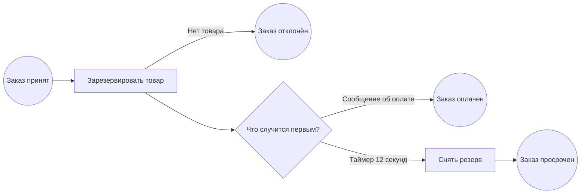

# Лабораторная по Camunda 8 · обработка заказа

[К оглавлению](../../theory/README.md) · [Camunda 7 и 8](../../theory/workflows/camunda.md) · [Вопросы для собеседования](../../interview/base/bpmn.md)

За 25–35 минут пройди одну ветку вручную и пять сценариев в Java-тестах. Перед каждым запуском назови следующий узел, который ожидаешь увидеть в Operate.



Схема выше показывает маршруты. В [исполняемой модели](order.bpmn) открой граничное Error Event у резерва и Event-based Gateway перед ожиданием. Файл можно посмотреть в Desktop Modeler, а после деплоя — в Operate. В лабораторной worker играет сам тест или человек, отправляющий REST-команды. Тип job содержит `orderId`, чтобы параллельные запуски не забирали задания соседних заказов. Обычно в приложении worker слушает постоянный тип операции, например `reserve-stock`.

## Запуск стенда

Понадобятся Docker Desktop с Linux-контейнерами и JDK 17 или новее для тестов проекта. Camunda 8.9.28 запускается со своей Java внутри контейнера. Из корня репозитория в PowerShell выполни следующие команды.

```powershell
$lab = 'docs/labs/camunda'
docker compose -f "$lab/compose.yaml" up -d
curl.exe --fail-with-body http://127.0.0.1:18088/v2/topology
```

Первый запуск скачивает образ и инициализирует локальную H2. Если API ещё недоступен, подожди и проверь `docker compose -f "$lab/compose.yaml" logs --tail 80 camunda`. В ответе `/v2/topology` ожидай одну партицию в состоянии `healthy`. [Operate](http://127.0.0.1:18088/operate) открывается с учебным логином `demo` и паролем `demo`. REST API слушает `127.0.0.1` и доступен без токена на этом стенде. [Настройки локальных стендов Camunda](https://docs.camunda.io/docs/8.9/self-managed/quickstart/developer-quickstart/docker-compose/configuration/)

## Пройди оплаченную ветку вручную

**1. Деплой и запуск.** Выполни из корня репозитория. `processDefinitionKey` выбирает версию схемы, а `processInstanceKey` находит конкретный заказ в Operate.

```powershell
$api = 'http://127.0.0.1:18088/v2'
$model = 'docs/labs/camunda/order.bpmn'
$deployed = curl.exe --fail-with-body -sS -F "resources=@$model" "$api/deployments" | ConvertFrom-Json
$definitionKey = $deployed.deployments[0].processDefinition.processDefinitionKey
$orderId = [guid]::NewGuid().ToString()
$start = @{ processDefinitionKey = $definitionKey; variables = @{ orderId = $orderId } }
$instance = Invoke-RestMethod -Method Post -Uri "$api/process-instances" -ContentType 'application/json' -Body ($start | ConvertTo-Json)
$instance.processInstanceKey
```

Открой экземпляр по ключу. Он ждёт на «Зарезервировать товар». Подписка на оплату появится после завершения резерва.

**2. Получи задание.** Представь, что запускаешь worker склада. `timeout` — время его работы с полученной job, `requestTimeout` — ожидание выдачи. Значения передаются в миллисекундах.

```powershell
$activation = @{
    type = "learn-reserve-$orderId"
    worker = 'manual'
    timeout = 120000
    requestTimeout = 3000
    maxJobsToActivate = 1
}
$jobs = Invoke-RestMethod -Method Post -Uri "$api/jobs/activation" -ContentType 'application/json' -Body ($activation | ConvertTo-Json)
$job = $jobs.jobs | Select-Object -First 1
$job | Select-Object jobKey, processInstanceKey, type, retries
```

Ожидай одну job и `retries = 3`. Если `jobs` пуст, повтори запрос активации. Дальше выполни следующий блок в пределах двух минут или после истечения таймаута повтори активацию.

**3. Отправь оплату раньше подписки и подтверди резерв.** `timeToLive` оставляет раннее сообщение в буфере. `complete` переводит экземпляр на шлюз, где подписка может подобрать сообщение.

```powershell
$payment = @{
    name = 'LearnPaymentReceived'
    correlationKey = $orderId
    messageId = "$orderId-payment"
    timeToLive = 120000
}
Invoke-RestMethod -Method Post -Uri "$api/messages/publication" -ContentType 'application/json' -Body ($payment | ConvertTo-Json)
Invoke-RestMethod -Method Post -Uri "$api/jobs/$($job.jobKey)/completion" -ContentType 'application/json' -Body '{}'
```

В Operate проверь, что выделен конечный узел «Заказ оплачен» (`OrderPaid`). История может появиться с небольшой задержкой. Повтори с новым заказом и `timeToLive = 0`, сохранив порядок вызовов. После 12 секунд ожидай шаг «Снять резерв». Заверши его, активировав тип `learn-release-$orderId` тем же способом. [REST API](https://docs.camunda.io/docs/8.9/apis-tools/orchestration-cluster-api-rest/orchestration-cluster-api-rest-overview/) · [Как работает буфер](https://docs.camunda.io/docs/8.9/components/concepts/messages/)

## Запусти тесты и сравни ветки

Из корня репозитория выполни команды с уже работающим стендом.

```powershell
$env:LAB_CAMUNDA_URL = 'http://127.0.0.1:18088'
.\mvnw.cmd '-Dtest=CamundaLabIntegrationTest' test
```

В Bash используй `LAB_CAMUNDA_URL=http://127.0.0.1:18088 ./mvnw -Dtest=CamundaLabIntegrationTest test`. Переменная включает [интеграционный тест](../../../src/test/java/ru/learn/interview/CamundaLabIntegrationTest.java). Каждый сценарий печатает `orderId` и `processInstanceKey` для поиска в Operate.

| Сценарий | Что воспроизводит тест | Что проверить |
|---|---|---|
| Ранняя оплата | Публикует сообщение до `complete` резерва | Заказ доходит до `OrderPaid` благодаря TTL |
| Нет товара | Отправляет `OUT_OF_STOCK` через BPMN Error | Граничное событие ведёт в `OrderRejected` |
| Оплата не пришла | Даёт таймеру сработать и завершает job снятия резерва | Заказ доходит до `OrderExpired` только после `complete` снятия |
| Склад возвращает 503 | Посылает `fail`, затем исчерпывает попытки и восстанавливает job | Появляется `JOB_NO_RETRIES`. После возврата попытки и разрешения incident та же job доходит до успеха |
| Worker пропал после записи | Создаёт резерв в отдельной H2 и даёт таймауту активации истечь | Новый worker получает тот же `jobKey` с прежними `retries`. В таблице по `order_id` остаётся одна запись |

**Упражнение с отладчиком.** В тесте `retriesATechnicalFailureAndResumesAfterResolvingTheIncident` поставь breakpoint перед `camunda.patch()`. Убедись, что в Operate виден incident, затем продолжи и посмотри, исчез ли он. В тесте `repeatsTheJobAfterTimeoutAndKeepsOneReservationInTheDatabase` поставь breakpoint после первого `insertReservation(jdbc)`. Объясни, какая запись уже зафиксирована и кому теперь доступна job. Уникальный ключ отвечает за один резерв даже при повторе.

**Вопрос после практики.** Платёж пришёл уже после `OrderExpired`. Что ответить клиенту и как не оставить его без денег и без товара? Обсуди источник правды о платеже, отдельную обработку поздних событий, компенсацию и её ключ идемпотентности.

Останови стенд командой `docker compose -f "$lab/compose.yaml" stop`. Именованный том сохранит историю для следующего запуска.
