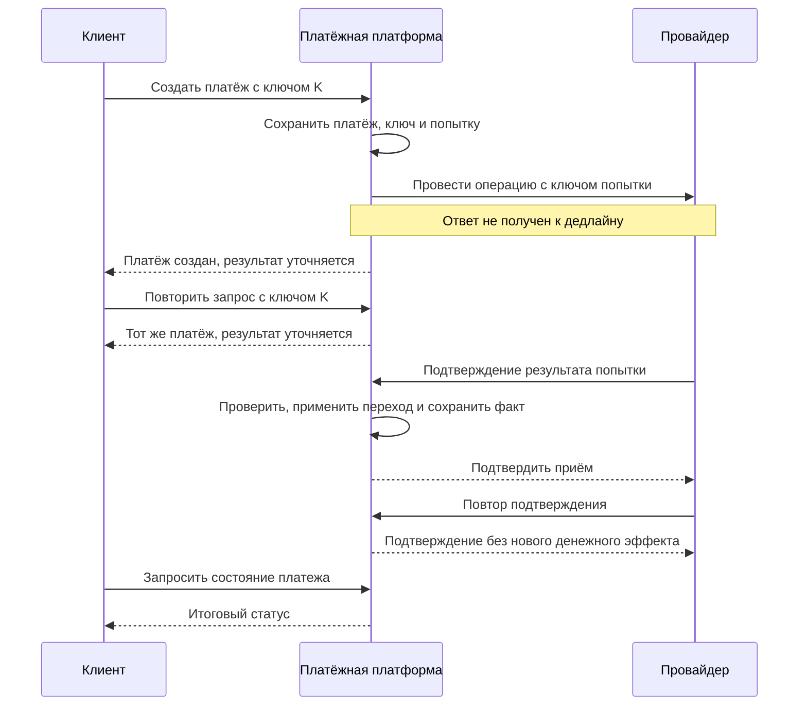

# Платёжная система: границы, состояния и повторы

[Архитектура и system design](../README.md) · [Требования](../design-process.md) · [Границы](../domain-boundaries.md) · [Контракты](../communications.md)

В этом примере мерчант — организация, в интересах которой выполняется платёж. Клиент или партнёр передаёт запрос платформе, а внешний провайдер выполняет свою часть операции и может сообщить итог позднее.

## Состояние и ответственность

| Что отслеживаем | За что отвечает владелец | Пример |
|---|---|---|
| Платёж и возврат | Приём запроса, допустимые переходы, итог по бизнес-правилам. | Платёж принят, в обработке, завершён или отклонён. Возврат связан с исходным платежом и имеет собственное состояние. |
| Попытка у провайдера | Связь внутренней попытки с внешним ответом и перевод статусов провайдера. | Запрос принят провайдером, ответ потерян, итог подтверждён при сверке. |
| Движение средств | Учёт движения денег и возможность объяснить каждую запись. | Списание, комиссия, возврат. |
| Уведомление мерчанту | Отдельный результат доставки. | Ждёт отправки, доставлено, требует вмешательства. |
| История, отчётность и сверка | История показывает операции, отчёт агрегирует данные, сверка сравнивает их с внешним источником. | У отчёта есть отметка свежести, а сверка обнаруживает неизвестный или расходящийся результат. |

Такое разделение требует разных моделей и правил, но не предписывает столько же сервисов. Входящий callback от провайдера уточняет исход операции; исходящее уведомление сообщает результат мерчанту.

## Инварианты

- Храни сумму точно вместе с валютой: например, целое число минимальных единиц для заданной валюты или десятичный тип с явным правилом округления. Не используй двоичный `float`/`double` для расчёта денежной суммы.
- У одной логической денежной операции не может быть двух денежных эффектов. Повтор API, повторная доставка callback и повтор уведомления решаются на разных границах.
- Сумма выполненных возвратов не превышает сумму завершённого платежа. Если возвраты выполняются асинхронно, резервируй доступный остаток на незавершённые возвраты или используй другой способ не пропустить два конкурирующих возврата. Проверку и изменение выполняет владелец в согласованной границе записи.
- Неизвестный исход остаётся неизвестным до подтверждения. Средства уже могли измениться; сбой доставки уведомления не отменяет платёж. После рестарта незавершённая работа должна оставаться доступной для обработки и сверки.

## Не смешивай идентификаторы

| Поле | Кто выдаёт | Что обозначает |
|---|---|---|
| `paymentId` | Платформа | Платёж. |
| `attemptId` | Платформа | Отдельную логическую попытку у провайдера. У платежа их может быть несколько. Повтор сетевого вызова для той же попытки не требует создания новой попытки. |
| `providerOperationId` | Провайдер | Внешнюю операцию; может отсутствовать до ответа или callback. Храни вместе с областью уникальности провайдера. |
| `ledgerEntryId` | Учёт | Запись о движении средств. На один платёж может приходиться несколько записей. |
| `eventId` | Источник события | Конкретное событие для дедупликации доставки. |
| `traceId` | Система трассировки | Техническую трассу. Один платёж может встречаться во многих трассах. |
| `idempotencyKey` | Клиент | Намерение, общее для повторов одного запроса. Для новой операции генерируется новый ключ. |

При первом запросе зафиксируй ключ в области клиента и операции вместе с отпечатком значимых параметров и связью с результатом. Повтор с теми же параметрами возвращает тот же результат или ссылку на ту же незавершённую операцию; повтор с изменившимися параметрами отклоняется по контракту. Защити запись от гонки, например ограничением уникальности. Срок хранения ключа должен покрывать ожидаемые повторы. Локальный ключ сам не устраняет дубль у провайдера: нужен согласованный с ним ключ, способ узнать статус или сверка. См. [AWS Builders’ Library: безопасные повторы](https://aws.amazon.com/builders-library/making-retries-safe-with-idempotent-APIs/).

## Сценарий: тайм-аут, поздний результат и повтор



Ответ о приёме подтверждает ровно то, что обещает контракт API, например создание внутренней записи. Входящий callback проверяют до применения, связывают с конкретной операцией и обрабатывают идемпотентно. Если callback не пришёл или расходится с текущим состоянием, владелец выясняет результат по контракту провайдера и данным сверки. Устаревшее уведомление не должно откатывать финальный статус.

## Что меняется при разделении данных

| Задача | Подход | Граница гарантии |
|---|---|---|
| Несколько изменений у одного владельца | Локальная транзакция и ограничения БД. | Атомарность действует только внутри участвующего хранилища. |
| Действия у разных владельцев | Saga: шаги и их результаты ведёт оркестратор либо участники реагируют на события. | Компенсация — отдельная бизнес-операция. Она тоже может завершиться ошибкой и потребовать восстановления. |
| Сохранение состояния и публикация | Outbox в одной транзакции с бизнес-изменением. Отдельный процесс забирает записи опросом или через CDC. | Публикация может повториться после сбоя; Outbox сохраняет намерение, но не устраняет дубликаты. |
| Применение события | Inbox или уникальный ключ эффекта в одной локальной транзакции с изменением. | Подтверждай сообщение после фиксации; внешний эффект требует отдельного контракта. |
| История и отчёты | CQRS разделяет операции записи и модель чтения; отдельное хранилище и асинхронная проекция используются по необходимости. | Для асинхронной проекции нужны предел отставания и способ перестроения. Денежное решение принимает владелец по актуальным данным. |

См. [Saga и CQRS](../service-architecture.md#8-паттерны-данных-и-интеграции) и [Outbox и CDC](../../messaging/delivery-patterns.md#9-outbox-и-cdc).

## Конкурентные частичные возвраты

Платёж на 1000 уже завершён, возвратов пока нет. Одновременно приходят две команды вернуть 700 и 500. Если каждая транзакция сделает `SELECT SUM(amount)` предыдущих возвратов, обе могут увидеть 0. Затем каждая вставит свою строку, и сумма заявок станет 1200. `UNIQUE (refund_id)` не поможет: это разные команды, обе с допустимыми ID. Защищать нужно общий доступный остаток.

Один возможный дизайн хранит на строке платежа остаток, доступный для новых возвратов. При создании заявки локальная транзакция сохраняет её и резервирует сумму атомарным обновлением. Сумму перед этим валидируют как положительное число в минимальных единицах той же валюты.

```sql
UPDATE payments
SET refundable_cents = refundable_cents - :amount
WHERE id = :paymentId
  AND status = 'SETTLED'
  AND refundable_cents >= :amount
RETURNING refundable_cents;
```

В PostgreSQL при `READ COMMITTED` конкурентное обновление той же строки ждёт и повторно сверяет условие с текущей версией строки. Если первым прошёл резерв 700, второму останется сравнить 500 с 300. Обновление затронет ноль строк. Сервис выяснит допустимый результат по контракту и не отправит вторую заявку провайдеру. Так же работает обратный порядок, тогда первой зарезервируется сумма 500. [PostgreSQL, Read Committed](https://www.postgresql.org/docs/17/transaction-iso.html#XACT-READ-COMMITTED)

### Провайдер подтвердил, отказал или замолчал

| Результат попытки | Состояние резерва | Следующий шаг |
| --- | --- | --- |
| Успех подтверждён | Сохраняем уменьшенный доступный остаток | Помечаем возврат завершённым и записываем движение денег |
| Окончательный отказ подтверждён | Возвращаем сумму в доступный остаток один раз | Сохраняем итог отказа в той же транзакции |
| Истёк тайм-аут без подтверждения | Держим резерв | Сверяем результат по ID попытки, проверяем callbacks и возраст резерва |
| Пришёл дубликат уведомления об отказе | Состояние уже окончательное | Отвечаем по контракту дубля, второго восстановления суммы нет |

При ошибке провайдера освобождение резерва и переход `PENDING → FAILED` должны сохраниться вместе. Например, условное обновление по текущему статусу определяет, кто единственный имеет право освободить средства. За счёт этого два одинаковых callback не вернут остаток дважды. Держать транзакцию с блокировкой строки на время HTTP к провайдеру дорого. Лучше зафиксировать резерв и намерение, затем выполнять внешний шаг отдельно. Для повтора API привяжи ключ запроса к уже созданной заявке, а при новом обращении к провайдеру используй стабильный ключ той же попытки.

<details>
<summary>После тайм-аута вернули резерв и приняли второй возврат. Как может нарушиться инвариант?</summary>

Первый возврат мог успешно пройти у провайдера. Освобождённый резерв позволил принять вторую сумму, а поздний callback подтвердил первую. При неизвестном исходе держи резерв и сверяй результат. Если этот период становится длинным, измеряй возраст pending и продумай ручное разрешение.

</details>

<details>
<summary>Почему один UPDATE защищает остаток, хотя приложение работает на нескольких экземплярах?</summary>

Все изменения проходят через одну строку владельца остатка. База координирует конкуренцию и проверяет условие изменения после ожидания. Важны общий путь записи и транзакция, которая связывает резерв с заявкой. В тесте задай сумму 1000, синхронизируй две транзакции и проверь, что суммы принятых заявок укладываются в лимит.

</details>

### Что проверить

| Сценарий | Ожидаемый результат |
|---|---|
| Два одновременных запроса с одним ключом | Один платёж и один логический денежный эффект. |
| Два частичных возврата конкурируют за остаток | Принятые резервы и выполненные возвраты не превышают доступную сумму. |
| Провайдер провёл операцию, но ответ потерялся | До подтверждения результат неизвестен. Поздний callback или сверка завершает операцию без нового списания. |
| Callback пришёл повторно или не по порядку | Нет повторного изменения средств и недопустимого перехода состояния. |
| Канал уведомлений или обработчик недоступен | Итог платежа сохранён. Возраст незавершённой работы виден; после восстановления обработка возобновляется. |
| Отчёт строится одновременно с платежами | Измерена задержка приёма и скорость завершения; денежные инварианты проверяются отдельно. |

Сигналы для каждого этапа: [наблюдаемость бизнес-сценария](../../operations/observability.md#наблюдаемость-бизнес-сценария). Требования к вызовам и callback: [границы доверия](../../security/application-security.md#границы-доверия-между-сервисами).
