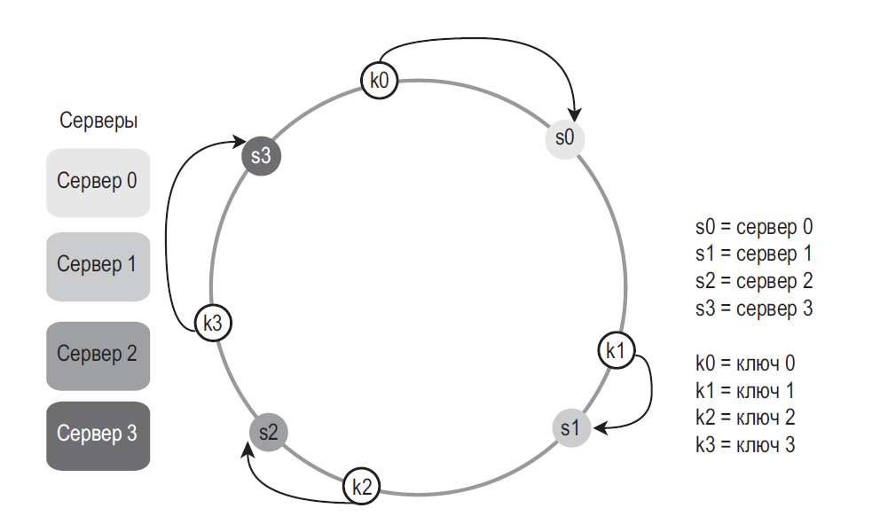
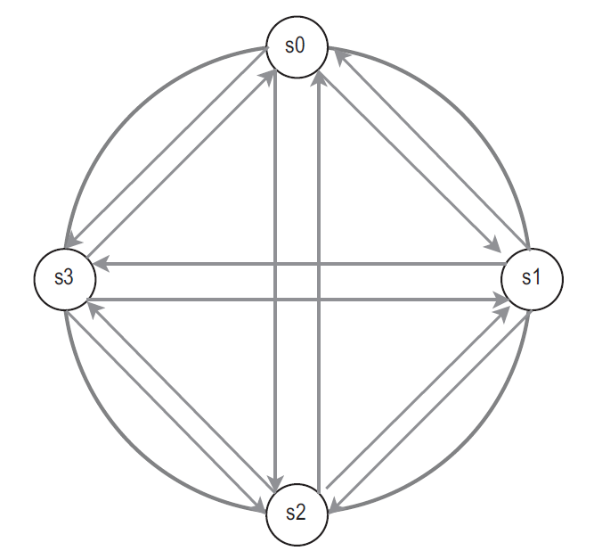
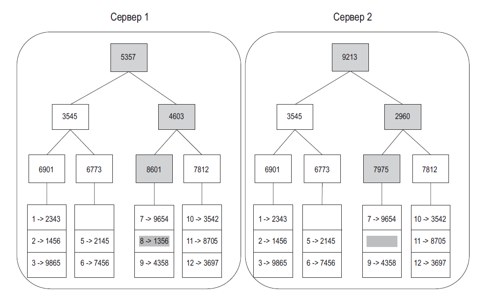
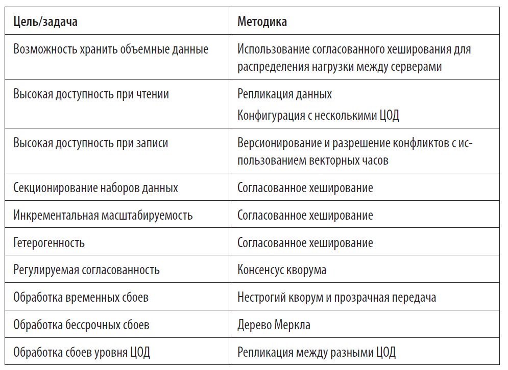

# Распределённые данные

[Архитектура и system design](README.md)

[Репликация и шардирование](#3-репликация-и-шардирование) · [CAP, PACELC и модели согласованности](#6-cap-pacelc-и-модели-согласованности) · [Согласованное хеширование](#согласованное-хеширование)

**Репликация копирует данные. Шардирование делит данные.** На интервью уточни, какую операцию нужно масштабировать и какое поведение допустимо при сетевом разделении.

## Репликация

- **Leader–follower.** Запись идёт в лидера, чтения можно разнести по репликам. При lag возможна потеря read-your-writes. Веди критичные чтения на лидера или жди нужную позицию репликации.
- **Синхронная и асинхронная.** При синхронной клиент ждёт подтверждения по выбранной политике. При асинхронной переключение может потерять подтверждённую запись, которую реплика ещё не получила.
- **Multi-leader.** Удобна для записи из нескольких регионов, нужна политика разрешения конфликтов. Last-write-wins проста, но может терять конкурентные обновления. Слияние возможно, если его допускают операции предметной области.
- **Leaderless.** Клиент или координатор пишет и читает несколько реплик. При фиксированных `N` и `R + W > N` множества пересекаются. Само пересечение ещё не гарантирует линеаризуемость: важны протокол, версии и конкурентные записи.
- **Восстановление.** При failover защити систему от двух активных лидеров, например через fencing. Для исправления расхождений применяют read repair и фоновую сверку реплик. В некоторых системах gossip распространяет сведения о состоянии узлов.

## Шардирование и решардинг

| Разбиение | Когда подходит | Цена |
|---|---|---|
| Hash | Запросы по ключу, равномерное распределение разных ключей | Диапазонный запрос может затронуть все шарды |
| Range | Сканирование диапазонов и локальность | Перекос, особенно при монотонном ключе записи |
| Directory | Нужна управляемая привязка ключа или tenant к шарду | Нужны метаданные и согласованное обновление маршрута |

**Согласованное хеширование.** Обычное `hash(key) % N` при смене числа узлов перемещает значительную долю ключей. Кольцо перемещает ключи затронутых диапазонов. Виртуальные узлы помогают распределять диапазоны. Rendezvous hashing решает похожую задачу без кольца. Популярный ключ сам по себе равномерным не станет.

**Переезд шарда.** Скопируй снимок, догоняй изменения из журнала, проверь расхождения, переключи маршрутизацию с защитой от старого писателя. Заранее определи, когда откат ещё возможен и как сохранить новые записи при откате.

## CAP, PACELC и модели согласованности

- **CAP** рассматривает сетевое разделение. Для конкретной операции приходится выбирать между линеаризуемостью и ответом каждого доступного узла. Например, денежный перевод может ждать восстановления связи, а лента может вернуть устаревшие данные.
- **PACELC** добавляет компромисс задержки и согласованности при штатной сети. Укажи конкретный режим записи и чтения.
- **Линеаризуемость** сохраняет порядок по реальному времени для завершённых операций. **Сериализуемость** требует эффекта некоторого последовательного исполнения транзакций. Это разные свойства.
- **Read-your-writes** сохраняет видимость собственных записей. **Monotonic reads** исключает возврат к уже пройденной версии в одной сессии. **Causal consistency** сохраняет порядок причинно связанных событий. **Eventual consistency** обещает сходимость без новых изменений при выполнении условий восстановления обмена.
- **Версии.** Логические часы дают порядок, векторные версии могут различать причинность и конкурентность. Выбор победителя или слияние зависит от модели данных.

[Изоляция транзакций в PostgreSQL](../data/postgresql/transactions.md) · [Кейс Key-Value](cases/key-value.md) · [Сохранение состояния в Redis](../data/redis-and-caching.md)


## 3. Репликация и шардирование

`[ ]` **Короткий ответ:** репликация копирует **одни и те же** данные на несколько узлов — для чтения и доступности. Шардирование делит данные на **разные** части по ключу — для объёма и записи. Это разные механизмы, их часто совмещают: каждый шард реплицируется.

### 3.1. Репликация

- Чтение можно распределить по репликам, если допустимы лаг и устаревшие данные. Запись обычно ограничена primary.
- Асинхронная репликация при failover может потерять последние изменения. Нужны мониторинг лага, выбор нового primary и защита от двух primary одновременно (split brain).
- **Реплика — не бэкап.** Ошибочный `DELETE` или повреждение данных реплицируется так же быстро, как полезная запись.

**Уточнение интервьюера:** «Пользователь сохранил профиль, обновил страницу и видит старые данные. Почему?» — чтение пошло на отстающую реплику. Решения: читать свои записи с primary некоторое время после изменения (read-your-writes), привязать сессию к primary, передавать позицию записи и ждать её на реплике.

### 3.2. Шардирование

`[ ]` **Короткий ответ:** все шарды имеют одну схему, но хранят разные строки. Главное решение — ключ шардирования: он определяет, какие запросы идут в один шард, а какие — во все сразу. Проблемы: решардинг, горячие шарды, межшардовые join и транзакции.

| Стратегия | Как | Плюсы | Минусы |
|---|---|---|---|
| По диапазону | `user_id 1–1M → шард 1` | Диапазонные запросы | Горячий «последний» шард при монотонных ключах |
| По хешу | `hash(key) % N` | Равномерно | Решардинг переносит почти все ключи |
| Consistent hashing | Кольцо хешей с виртуальными узлами | При добавлении узла переезжает ~1/N ключей | Сложнее, нужны vnodes для равномерности |
| По справочнику | Таблица «ключ → шард» | Гибко, можно переносить отдельных клиентов | Справочник сам должен быть доступен и быстр |

<details>
<summary>Три главные проблемы шардирования</summary>

**Решардинг.** Шард переполнился, или данные распределились неравномерно. Нужно изменить функцию распределения и перенести данные без простоя. Помогают consistent hashing и заранее созданные «логические» шарды (например, 1024 логических на 8 физических серверов: переносится логический шард целиком).

**Проблема знаменитостей (hot key).** Если данные нескольких очень популярных аккаунтов попали в один шард, он перегружен чтениями. Решения: кеш перед шардом, отдельный шард для таких ключей, разбиение ключа на под-ключи (`celebrity:42#0..#15`) с агрегацией при чтении.

**Join и транзакции.** Соединения и транзакции через несколько шардов дороги или невозможны. Решения: выбирать ключ так, чтобы связанные данные лежали вместе (все заказы клиента — в шарде клиента); денормализация; асинхронные проекции для отчётов.

</details>

### Лабораторная 1. Решардинг

`[ ]` Сравните, сколько ключей переезжает при переходе с 4 на 5 узлов для `hash % N` и consistent hashing.

<details>
<summary>Код (запуск: java Sharding.java)</summary>

```java
import java.nio.charset.StandardCharsets;
import java.security.MessageDigest;
import java.util.*;

public class Sharding {
    static long hash(String s) {
        try {
            byte[] d = MessageDigest.getInstance("MD5").digest(s.getBytes(StandardCharsets.UTF_8));
            long h = 0;
            for (int i = 0; i < 8; i++) h = (h << 8) | (d[i] & 0xff);
            return h;
        } catch (Exception e) { throw new RuntimeException(e); }
    }

    static int modulo(String key, int shards) { return (int) Math.floorMod(hash(key), (long) shards); }

    static final class Ring {
        final TreeMap<Long, String> ring = new TreeMap<>();
        Ring(int nodes, int vnodes) {
            for (int n = 0; n < nodes; n++)
                for (int v = 0; v < vnodes; v++) ring.put(hash("node-" + n + "#" + v), "node-" + n);
        }
        String nodeFor(String key) {                       // первый узел по часовой стрелке
            var e = ring.ceilingEntry(hash(key));
            return (e != null ? e : ring.firstEntry()).getValue();
        }
    }

    public static void main(String[] args) {
        int keys = 100_000, movedMod = 0, movedRing = 0;
        Ring before = new Ring(4, 100), after = new Ring(5, 100);
        for (int i = 0; i < keys; i++) {
            String k = "user:" + i;
            if (modulo(k, 4) != modulo(k, 5)) movedMod++;
            if (!before.nodeFor(k).equals(after.nodeFor(k))) movedRing++;
        }
        System.out.printf("hash %% N: moved %.1f%%%n", 100.0 * movedMod / keys);
        System.out.printf("ring:     moved %.1f%%%n", 100.0 * movedRing / keys);
    }
}
```

</details>

<details>
<summary>Результат запуска</summary>

| Схема | Переехало ключей при 4 → 5 |
|---|---|
| `hash % N` | **80,1%** |
| Consistent hashing, 100 виртуальных узлов | **18,9%** (теоретически 1/5 = 20%) |

Распределение 100 000 ключей по 5 узлам:

| Виртуальных узлов на сервер | node-0 | node-1 | node-2 | node-3 | node-4 |
|---|---|---|---|---|---|
| 100 | 20 555 | 18 884 | 21 276 | 20 407 | 18 878 |
| 1 | 16 483 | 27 795 | 5 962 | 40 733 | 9 027 |

Вывод: consistent hashing уменьшает переезд с ~80% до ~1/N, но без виртуальных узлов распределение очень неравномерное — один узел получил 41% ключей, другой 6%.

</details>

---


## 6. CAP, PACELC и модели согласованности

### 6.1. CAP

`[ ]` **Короткий ответ:** CAP говорит о поведении **во время сетевого разделения**. Если узлы не могут связаться, система либо отклоняет часть запросов, чтобы не вернуть устаревшие или конфликтующие данные (сохраняет C), либо продолжает отвечать, допуская расхождение (сохраняет A). Без разделения выбирать «два из трёх» не нужно.

- **C** в CAP — линеаризуемость: чтение видит последнюю успешно завершённую запись.
- **A** — каждый запрос к работающему узлу получает ответ, а не ошибку или таймаут.
- **P** — способность работать при потере связи между узлами. В распределённой системе разделения неизбежны, поэтому P не «выбирают».

> Буква C в CAP и C в ACID — разные понятия. В ACID это соблюдение инвариантов и ограничений, в CAP — линеаризуемость.

<details>
<summary>Почему метки «CP» и «AP» вводят в заблуждение</summary>

Поведение зависит от операции, настроек и конкретного отказа. Одна и та же Cassandra с `QUORUM` ведёт себя иначе, чем с `ONE`. PostgreSQL с синхронной репликацией ведёт себя иначе, чем с асинхронной.

На интервью полезнее описать конкретный сценарий: какие запросы принимаются при потере кворума, можно ли читать устаревшую реплику, что произойдёт с подтверждёнными записями, как разрешаются конфликты после восстановления связи.

</details>

### 6.2. Модели согласованности

`[ ]` **Короткий ответ:** от сильной к слабой: линеаризуемость → причинная согласованность → согласованность в конечном счёте. Сильные гарантии требуют координации между узлами, а значит, задержки и меньшей доступности при отказах.

| Модель | Гарантия | Пример |
|---|---|---|
| Линеаризуемость | Операция выглядит атомарной в момент между вызовом и ответом; после завершения записи все её видят | Распределённая блокировка, лидер в etcd |
| Сериализуемость | Результат транзакций эквивалентен **какому-то** последовательному порядку | `SERIALIZABLE` в СУБД |
| Причинная (causal) | Причинно связанные изменения видны в правильном порядке; независимые — в любом | Ответ на комментарий не виден раньше самого комментария |
| Read-your-writes | Клиент видит свои записи | Профиль после сохранения |
| Монотонное чтение | Клиент не видит, как данные «откатываются» назад | Счётчик не уменьшается при обновлении страницы |
| В конечном счёте (eventual) | Если записи прекратятся, реплики сойдутся | DNS, кеши, проекции CQRS |

**Уточнение интервьюера:** «Чем линеаризуемость отличается от сериализуемости?»

<details>
<summary>Ответ</summary>

Сериализуемость — свойство транзакций из нескольких операций: результат эквивалентен некоторому последовательному порядку, но этот порядок может не совпадать с реальным временем. Линеаризуемость — свойство отдельных операций над одним объектом: порядок согласован с реальным временем. Сериализуемая система может вернуть устаревшее чтение, если это вписывается в допустимый порядок. Сочетание обоих свойств называют строгой сериализуемостью (strict serializability).

</details>

### 6.3. PACELC и кворумы

`[ ]` **Короткий ответ:** PACELC дополняет CAP: при разделении (P) — выбор между A и C, иначе (E) — между задержкой (L) и согласованностью (C). Например, чтение с ближайшей асинхронной реплики быстрее, но может вернуть устаревшие данные.

Кворум: `N` реплик, запись подтверждается `W` репликами, чтение опрашивает `R`. Если `R + W > N`, множества читающих и пишущих реплик пересекаются.

| N | R | W | R + W > N | Свойство |
|---|---|---|---|---|
| 3 | 1 | 1 | нет | Быстро, но можно прочитать старое |
| 3 | 2 | 2 | да | Сбалансированный кворум, выдерживает отказ 1 узла |
| 3 | 1 | 3 | да | Быстрое чтение, запись недоступна при отказе любого узла |
| 3 | 3 | 1 | да | Быстрая запись, чтение недоступно при отказе любого узла |

**Уточнение интервьюера:** «Значит, при `R + W > N` система линеаризуема?»

<details>
<summary>Ответ</summary>

Нет. Пересечение кворумов гарантирует, что чтение увидит хотя бы одну реплику с последней подтверждённой записью — при условии, что можно определить, какая версия новее. Линеаризуемость ломают конкурирующие записи с разрешением «последний по часам выигрывает» (часы расходятся), sloppy quorum и hinted handoff (запись приняли «чужие» узлы), частично выполненная запись (не набрала `W`, но осталась на части реплик), чтение без исправления реплик (read repair). Для линеаризуемости нужен консенсус (Raft, Paxos) или дополнительные механизмы.

</details>

### 6.4. Памятка: PACELC

`[ ]` **Короткий ответ:** PACELC (Дэниел Абади, 2010/2012) — «if **P** then **A** or **C**, **E**lse **L** or **C**». CAP описывает только редкий случай разделения сети, а PACELC добавляет компромисс, который есть **всегда**: как только данные реплицируются, приходится выбирать между быстрым ответом и согласованностью реплик.

**Формула в одну строку:**

```text
Разделение сети (P)?
├── да  → PA: отвечаем, допуская расхождение   | PC: отказываем части запросов
└── нет (E) → EL: подтверждаем сразу, реплицируем асинхронно | EC: ждём реплики (кворум/все), потом отвечаем
```

**Четыре класса:**

| Класс | При разделении | В норме | Примеры (по умолчанию) | Где уместно |
|---|---|---|---|---|
| PA/EL | Доступность | Низкая задержка, eventual | DynamoDB, Cassandra, Riak | Ленты, лайки, каталоги, кеши сессий, рекомендации |
| PC/EC | Согласованность | Согласованность, выше задержка | Spanner, HBase, CockroachDB, YugabyteDB | Деньги, остатки на складе, бронирование |
| PA/EC | Доступность | Согласованность | MongoDB (базовая конфигурация), Hazelcast | Обычно сильная согласованность, но failover важнее простоя |
| PC/EL | Согласованность | Низкая задержка | Yahoo PNUTS | Быстро в норме; при сбое — отключить операции, а не ухудшать гарантии |

**Что запомнить:**

- **CA-систем не бывает:** P не выбирают, а без разделения всё равно нельзя получить и нулевую задержку, и идеально согласованные реплики.
- **Eventual consistency — не только про аварии:** часто это сознательный выбор ради скорости при исправной сети.
- **Шкала, а не переключатель:** уровни `ONE` / `QUORUM` / `ALL` в Cassandra, 5 уровней в Cosmos DB (`Strong` ≈ PC/EC, `Session`/`Eventual` ≈ PA/EL), чтение со вторичных реплик в MongoDB двигают систему между EL и EC.
- **Классы смешиваются в одной системе:** каталог магазина — из кеша (EL), оплата и остатки — со строгой согласованностью (EC).
- **CAP → PACELC:** CP обычно становится PC/EC, AP — PA/EL.

<details>
<summary>Запись по шагам: PA, PC, EL, EC</summary>

| Режим | Что делает узел A при записи | Цена |
|---|---|---|
| PA | Реплика B недоступна → A принимает запись локально и отвечает `OK`; после восстановления связи — догоняющая репликация, read repair, anti-entropy, разрешение конфликтов (например, last write wins) | Расхождение данных, риск двойной продажи |
| PC | Реплика B не подтвердила → A возвращает ошибку или таймаут (или работает только кворум большинства, меньшинство ждёт) | Часть клиентов получает отказ |
| EL | Применяет локально → сразу отвечает → асинхронно отправляет в B | Чтение с B может вернуть старое |
| EC | Синхронно реплицирует в B (кворум или все) → ждёт подтверждения → отвечает | Задержка растёт на сетевой круг (межрегионально — десятки и сотни мс) |

</details>

<details>
<summary>Ограничения модели</summary>

- **Бинарность:** между строгой и eventual есть целый спектр (причинная, read-your-writes, монотонное чтение — см. [6.2](#62-модели-согласованности)).
- **Метки условны:** класс зависит от настроек и конкретной операции, как и с CP/AP в [6.1](#61-cap).
- **PA/EC и PC/EL запутывают:** PC у PNUTS не значит «абсолютная согласованность», а значит, что при сбое гарантии не опускаются ниже базовых (timeline consistency) — вместо этого отключается часть операций.
- **Модель молчит** о пропускной способности, стоимости координации, транзакциях и изоляции (ACID/BASE), механизмах консенсуса (Raft/Paxos).

</details>

**Уточнение интервьюера:** «Отнесите вашу систему к классу PACELC».

<details>
<summary>Как отвечать</summary>

Не называть одну метку на всю систему, а ответить на два вопроса для каждого типа данных: 1) что происходит с данными, если сеть разделится надвое — кто продолжает принимать записи и как потом сводятся конфликты; 2) на какие уступки в согласованности мы идём ради миллисекунд в обычном режиме. Пример: «Лента — PA/EL (Cassandra, `ONE`), платежи — PC/EC (PostgreSQL с синхронной репликацией или Spanner); для профиля пользователя достаточно read-your-writes».

</details>

### 6.5. Памятка: модели согласованности

`[ ]` **Короткий ответ:** модель согласованности — это гарантия того, в каком порядке и насколько свежими клиенты видят записи на разных репликах. Чем сильнее модель, тем больше координации между узлами, а значит, выше задержка и ниже доступность при разделении. Сильную модель включают точечно (деньги, блокировки), слабую — везде, где допустимо отставание.

**Шкала от сильной к слабой:**

```text
Строгая (линеаризуемость) → Последовательная → Причинная → Eventual
   реальное время           общий порядок      порядок только     только сходимость
   + общий порядок          без реального      для связанных      «когда-нибудь»
                            времени            событий
```

| Модель | Что гарантирует | Как достигается | Цена | Где применять |
|---|---|---|---|---|
| Строгая (linearizable) | Чтение видит последнюю завершённую запись; система ведёт себя как одна копия | Консенсус (Raft, Paxos), синхронная репликация, кворум большинства | Задержка на каждую запись, недоступность записи при разделении, ограниченная пропускная способность | Платежи, балансы, распределённые блокировки, выбор лидера, конфигурация кластера |
| Последовательная (sequential) | Все узлы видят операции в одном порядке; порядок каждого процесса сохранён; реальное время не учитывается | Глобальный порядок: секвенсор, рассылка с полным порядком (total order broadcast) | Возможны устаревшие чтения; секвенсор может стать узким местом | Многопользовательские игры, совместное редактирование |
| Причинная (causal) | Причина видна раньше следствия; параллельные операции — в любом порядке | Векторные часы, логические метки, отложенное применение до прихода зависимостей | Метаданные о зависимостях; конфликты параллельных записей решать самому | Мессенджеры, комментарии, вики, соцсети |
| Eventual | Если записи прекратятся, реплики сойдутся | Асинхронная репликация, gossip, разрешение конфликтов (LWW, слияние, CRDT) | Устаревшие и конфликтующие чтения; LWW теряет записи; трудно воспроизводимые баги | CDN и кеши, DNS, счётчики лайков и просмотров, связи между микросервисами |

**Сессионные (клиентские) гарантии** — надстройка над eventual: согласованность для одного клиента, а не для всех.

| Гарантия | Смысл | Пример |
|---|---|---|
| Read Your Writes | Клиент видит свои записи | Добавил товар — он сразу в корзине |
| Monotonic Reads | Чтения не «откатываются» назад | Баланс 100 не превращается обратно в 90 |
| Monotonic Writes | Записи клиента применяются в порядке отправки | Изменил, потом удалил — не наоборот |
| Writes Follow Reads | Запись применяется после того, что клиент уже прочитал | Комментарий не окажется раньше тех, на которые вы ответили |

Реализация: привязать сессию к реплике или передавать с запросом токен версии (например, LSN или session token в Cosmos DB), чтобы реплика ответила, только когда догонит эту версию. Второй способ лучше: он не создаёт проблем sticky sessions (см. [раздел 4](scaling.md#4-балансировка-и-состояние)).

**Что запомнить:**

- **Последовательная ≠ строгая:** порядок общий, но может отставать от реального времени.
- **Причинная = eventual + зависимости:** почти так же быстро, но без эффекта «ответ раньше вопроса». Глобальные инварианты (например, «остаток ≥ 0») она не защищает.
- **BASE vs ACID:** Basically Available, Soft state, Eventual consistency — противоположность жёстких ACID-транзакций.
- **Микросервисы:** внутри сервиса — ACID в своей БД; между сервисами — eventual через события, Saga с компенсациями вместо 2PC (см. [8.3](service-architecture.md#83-saga)), outbox/inbox для надёжной доставки, идемпотентные обработчики, периодические сверки.
- **Модели смешивают по доменам:** каталог и лента — eventual, корзина — сессионные гарантии, оплата и склад — строгая.

<details>
<summary>Пример: заказ в микросервисах</summary>

Сервисы Order, Inventory, Payment, Notification. Order сразу показывает пользователю «заказ создан» и публикует событие. Payment списывает деньги, Notification отправляет письмо — асинхронно, через секунды. Пользователь не ждёт и не получает ошибку, если Notification временно недоступен: событие обработается после восстановления. Важный инвариант «не уменьшать склад без оплаты» защищает сага: Inventory резервирует товар, а при отказе оплаты резерв снимается компенсирующим действием.

</details>

**Уточнение интервьюера:** «Пользователь сохранил профиль, обновил страницу и увидел старые данные. Что произошло и как исправить?»

<details>
<summary>Ответ</summary>

Запись ушла на лидера, а чтение — на асинхронную реплику, которая ещё не догнала: нарушен read-your-writes. Варианты: читать свои данные с лидера какое-то время после записи; передавать с запросом версию последней записи и ждать, пока реплика её догонит; использовать сессионный уровень согласованности СУБД. Делать всю систему линеаризуемой ради этого не нужно.

</details>

---


## СОГЛАСОВАННОЕ ХЕШИРОВАНИЕ

Для обеспечения горизонтального масштабирования запросы/данные должны распределяться между серверами эффективно и равномерно. Для этого зачастую используется согласованное хеширование

Простое распределение `serverIndex = hash(key) % N` легко реализовать, но при изменении `N` большая часть ключей переезжает. Согласованное хеширование размещает узлы и ключи на кольце и при изменении состава обычно перемещает только часть ключей; альтернативой может быть rendezvous hashing.

При modulo hashing добавление/удаление узла меняет остаток и часто переназначает ключи. У consistent hashing перемещается меньшая доля ключей, но равномерность не гарантирована автоматически и зависит от количества/веса виртуальных узлов, распределения нагрузки и hot keys.



### Виртуальные узлы
Виртуальные узлы дают каждому физическому серверу несколько позиций на кольце и обычно уменьшают разброс распределения. Больше виртуальных узлов требуют больше metadata и не решают hot-key сами по себе; число подбирают нагрузочным тестом.

### Согласованность

Так как данные реплицируются по нескольким узлам, чтения и записи могут использовать quorum. Это не всегда консенсус-протокол и не универсальная гарантия линейризуемости; сначала определите модель конкретного хранилища.
- **N** = количество реплик.
- **W** = кворум **записи** размера W. Операция записи считается успешной, только если она подтверждена W репликами.
- **R** = число реплик, от которых ждут ответ при чтении.

Как сконфигурировать N, W и R для наших задач? Вот несколько возможных вариантов:
- если **R = 1 и W = N**, система оптимизирована для **быстрого чтения**;
- если **W = 1 и R = N**, система оптимизирована для **быстрой записи**;
- если **W + R > N**, кворумы пересекаются при заданных предположениях о размещении и ответах реплик;
- пересечение само по себе не гарантирует линейризуемость: важны разрешение конфликтующих/конкурентных записей, версии, failover и конкретная реализация quorum/sloppy quorum.

### Модели согласованности
Модель согласованности — еще один важный фактор, который следует учитывать при проектировании хранилища типа «ключ–значение». Она определяет степень согласованности данных и имеет широкий спектр разновидностей.
- **Линейризуемость**. Операции выглядят атомарными и соблюдают real-time порядок: чтение после завершившейся записи видит её результат. Это не требует обязательного подтверждения от всех реплик, но требует достаточной координации согласно протоколу.
- **Слабая согласованность**. Последующие _операции чтения могут и не вернуть самое последнее значение_.
- **Согласованность в конечном счёте**. Если обновления прекратятся и система восстановит обмен, реплики в итоге сойдутся; срок сходимости и разрешение конфликтов нужно определить отдельно.

### Устранение несогласованности: версионирование

**Векторные часы** — отображение `nodeId → counter`, связанное с версией данных. Сравнение векторов показывает причинный порядок или конкурентность версий; при конфликте требуется правило слияния/разрешения, а не просто выбор «большей».

### Обнаружение сбоев



Более оптимальное решение состоит в использовании децентрализованных методов обнаружения сбоев, таких как протокол сплетен (gossip protocol). Он работает следующим образом.

- Каждый узел хранит список узлов-участников, состоящий из идентификаторов и счетчиков пульсации.
- Каждый узел периодически инкрементирует счетчик пульсации.
- Каждый узел периодически шлёт пульс группе узлов, которые могут передавать сведения дальше.
- При получении пульса узлы обновляют список участников до последней версии.
- Если счётчик пульсации не увеличивается в течение таймаута, узел помечают подозреваемым в отказе; сетевой раздел может дать ложное подозрение.

Для обнаружения несогласованности и минимизации объема передаваемых данных используется **дерево Меркла**

**Дерево Меркла** строит хеши листьев из блоков данных, а внутренние узлы — из хешей потомков с однозначным кодированием. Сравнение корневых хешей помогает эффективно находить различающиеся части больших наборов данных; это не механизм консенсуса и не шифрование.




