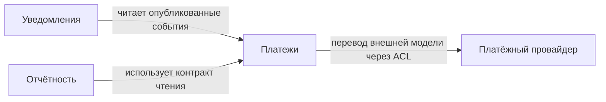

# Границы системы: DDD, данные и модульный монолит

[Архитектура и system design](README.md) · [Как находить требования](design-process.md) · [Контракты](communications.md) · [Пример: платежи](cases/payments.md)

**Граница отвечает на два вопроса: кто принимает бизнес-решение и кто вправе менять состояние.** Пакет, схема БД и самостоятельный процесс по-разному закрепляют эту границу.

## Как найти ограниченные контексты

**Ограниченный контекст (bounded context)** — область, в которой действуют согласованные модель и язык. Для интеграции «платёж» может означать операцию со статусом провайдера, для учёта — движение средств, для отчётности — строку со временем и итогом. Попытка поместить все смыслы в один объект заставляет каждый сценарий учитывать чужие правила. Веди общий словарь внутри контекста: понятия и их имена должны совпадать в разговоре с экспертами, документации и коде. См. [Bounded Context у Мартина Фаулера](https://martinfowler.com/bliki/BoundedContext.html).

1. Из сценариев выпиши сущности и действия: платёж, попытка, проводка, возврат; принять, зарезервировать, подтвердить, сверить.
2. Разложи их по смыслу. Ищи конфликт значений, разные источники правил и разные причины изменения. В истории Git проверь, какие участки регулярно меняются вместе.
3. Пройди по каждому значимому сценарию через предложенные границы. Определи, где исполняется инвариант и кто публикует результат. Многократные переходы туда и обратно или спор о владельце записи — повод перепроверить границу.

| Граница | Что отделяет |
|---|---|
| Ограниченный контекст | Значение понятий и применимые правила. |
| Модуль | Публичный интерфейс кода и скрытую реализацию. |
| Таблица, схема или БД | Физическое размещение данных, права доступа и возможности локальных транзакций. |
| Сервис | Самостоятельный жизненный цикл, развертывание, сетевой контракт и ресурсы. |

## Карта отношений между контекстами

**Upstream** задаёт контракт или модель; **downstream** от них зависит. Это направление влияния на контракт: HTTP-запрос может идти в одну сторону, а уведомление — в другую. На карте отмечай, что означает каждая стрелка и где переводятся данные.

| Отношение | Когда уместно | Цена |
|---|---|---|
| Партнёрство | Два контекста совместно развивают общий сценарий и договариваются о выпуске. | Требуется постоянная координация. |
| Заказчик и поставщик | Потребитель может влиять на приоритеты поставщика контракта. | Нужен явный процесс согласования. |
| Конформист | Downstream сознательно принимает модель upstream как есть. | Изменения upstream напрямую влияют на потребителя. |
| Антикоррупционный слой (ACL) | Внешние статусы, ошибки и форматы нужно переводить в локальные понятия. | Появляются правила перевода и тесты для неожиданных значений. |
| Открытый сервис и опубликованный язык | Upstream предоставляет контракт, а схему и семантику публикует для потребителей. | Нужна совместимая эволюция контракта. |
| Раздельные пути | Связь не приносит достаточно пользы. | Часть работы может дублироваться; подписка на общий факт уже создаёт связь и не относится к этому варианту. |

На примере платежей: провайдер задаёт внешний контракт, адаптер переводит его статусы в локальный язык, отчётность получает ограниченный набор фактов через согласованный интерфейс. Уведомления читают факт о результате платежа и самостоятельно владеют состоянием доставки. Для такой карты достаточно моделей, связей и их типа; размещение приложений и БД покажи на [схеме C4](design-process.md#какие-документы-помогают-принять-решение).

На этой карте стрелка идёт от зависимого контекста к поставщику контракта. Например, факт о платеже приходит **в** уведомления, но от его схемы зависят именно уведомления.

## Владение данными и доступ на чтение

Владелец решает, какому состоянию можно доверять и какие изменения допустимы. В общей БД у таблиц могут быть разные владельцы: соседние модули обращаются через публичный контракт, не пишут напрямую и не привязываются к внутренней схеме. Отдельная БД сама по себе не обеспечивает владение, если её сервис разрешает изменять данные в обход бизнес-правил.

Для каждого читателя запиши поля, допустимое отставание, объём и нужную полноту. Проверка доступной суммы возврата выполняется владельцем на актуальном состоянии и защищается от конкурентной записи. Отчёту за месяц может подойти проекция с задержкой, если понятны её полнота и отметка «данные на». Копия для аналитики не участвует в проверке денежного лимита.

Аналогично с правами: если список доступных организаций большой и часто меняется, полная копия списка в каждом JWT раздувает запросы и долго сохраняет старые права. Определи владельца политики доступа; проверяй разрешение на конкретную организацию по управляемому контракту. Срок жизни кэша согласуй с требованиями к отзыву доступа.

## Как закрепить границы в Java

1. Для каждого модуля выдели публичные операции, типы и события; сущности, репозитории и адаптеры оставь внутренними. Отметь допустимые зависимости. Цикл — повод проверить, не раздвоена ли одна ответственность и не нужен ли отдельный контракт.
2. В Spring Boot можно описать границы через [Spring Modulith](https://docs.spring.io/spring-modulith/reference/fundamentals.html). По умолчанию модули определяются по непосредственным подпакетам корня приложения. Базовый пакет модуля содержит API; для экспортируемого вложенного API используй `@NamedInterface`. Список допустимых зависимостей задаётся через `@ApplicationModule(allowedDependencies = …)`.
3. Запусти `ApplicationModules.of(Application.class).verify()` в тесте. [Проверка](https://docs.spring.io/spring-modulith/reference/verification.html) ловит циклы модулей, нарушения доступа к внутренним типам закрытых модулей и выход за границы заданного списка зависимостей. `@ApplicationModuleTest` помогает отдельно проверить поведение модуля.
4. Для дополнительных правил об импортах, слоях и вызовах пригоден [ArchUnit](https://www.archunit.org/userguide/html/000_Index.html). Проверка Java-зависимостей сама не доказывает, что запрос не читает чужую таблицу. Для путей через SQL нужны отдельные проверки и, где применимо, ограничения прав БД.

**Когда идти дальше:** физическое разделение данных убирает возможность одной обычной локальной транзакции на оба хранилища. Вынос процесса добавляет сетевые отказы, совместимость версий и эксплуатацию. У каждой перемены должен быть свой мотив: например, независимый выпуск или изоляция нагрузки. Если внутренние границы решают задачу, модульный монолит может быть целевой архитектурой. См. [сравнение архитектур](service-architecture.md#5-монолит-модульный-монолит-микросервисы).
