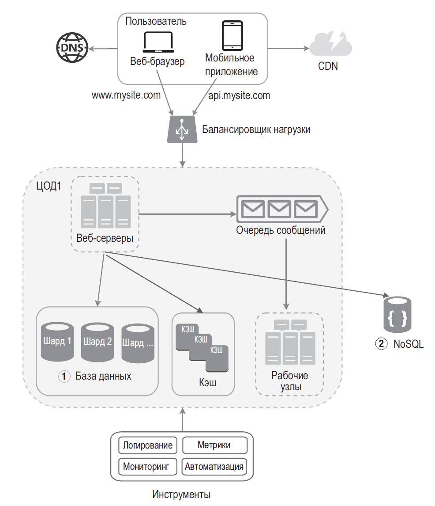

# Architecture
Шаги, которые предпринимаются в ходе масштабирования системы для поддержки миллионов пользователей:
- веб-уровень не должен хранить состояния
- резервирование должно быть предусмотрено на каждом уровне
- кэширование данных следует проводить как можно более активно
- система должна поддерживать больше одного центра обработки данных
- статические ресурсы нужно хранить в CDN
- для масштабирования данных следует применять шардинг
- уровни должны быть разделены на отдельные сервисы
- необходимо выполнять мониторинг системы и использовать средства автоматизации
  

### CDN (Content Delivery Network)
CDN — это сеть географически распределенных серверов, которая используется для доставки **статического** содержимого. Серверы CDN кэшируют такие статические файлы, как изображения, видео, CSS, JavaScript и т. д.
Вот общий принцип работы CDN: когда пользователь посещает веб-сайт, ближайший к нему сервер CDN доставляет **статическое** содержимое.

### Разные ЦОДы
Для реализации архитектуры с несколькими центрами обработки данных необходимо решить несколько технических вопросов.
- Перенаправление трафика. Необходимы эффективные инструменты для направления трафика к подходящему ЦОД. GeoDNS позволяет выбирать центр обработки данных, который находится ближе всего к пользователю.
- Синхронизация данных. Пользователи могут работать с разными локальными базами данных и кэшами в зависимости от региона. В случае сбоя трафик может быть перенаправлен к ЦОД, в котором нет запрашиваемых данных. Распространенным решением является репликация данных между несколькими ЦОД.
- Тесты и развертывание. В конфигурации с несколькими ЦОД тестирование веб-сайта/приложения необходимо проводить в разных местах. Автоматические средства развертывания незаменимы в поддержании согласованности всех ЦОД.

### Масштабирование
#### Сервисы
- Вертикальное - простое, имеет ряд ограничений. 1) имеет лимит. Не получится добавлять ресурсы бесконечно. 2) Не предусматривает отказоустойчивость
- Горизонтальное - добавление новых под, и использование балансировщика нагрузки. Балансировщик нагрузки имеет внешний IP, по которому обращаются к сервисам. Балансировщик же обращается к подам по внутреннему IP

#### БД
Горизонтальное масштабирование - **Шардинг** позволяет разделить крупные наборы данных на более мелкие и простые в использовании части, которые называют шардами. Все шарды имеют одну и ту же схему, но каждый из них хранит уникальные данные. Шардинг отлично подходит для масштабирования баз данных, но это далеко не идеальное решение. Оно усложняет систему и создает дополнительные трудности.
Недостатки:
- Повторное сегментирование данных. Это может понадобиться, когда 1) отдельный шард полностью заполняется из-за стремительного развития системы или 2) некоторые шарды заполняются быстрее других из-за неравномерного распределения данных. В такой ситуации необходимо обновить функцию сегментирования и переместить имеющиеся данные. Для решения этой проблемы зачастую применяют согласованное хеширование
- Проблема знаменитостей. Слишком частое обращение к определенному шарду может вызвать перегрузку сервера. Представьте, что информация о Кэтти Перри, Джастине Бибере и Леди Гаге очутилась в одном и том же сегменте. Если речь идет о социальных приложениях, этот сегмент будет перегружен операциями чтения. Для решения этой проблемы, возможно, придется выделить по отдельному шарду для каждой знаменитости. Может случиться так, что каждый сегмент потребует дальнейшего разделения.
- Соединение и денормализация. После сегментирования базы данных между несколькими серверами становится сложно выполнять операции соединения, охватывающие несколько шардов. Распространенное решение состоит в денормализации базы данных таким образом, чтобы запросы могли выполняться в рамках одной таблицы.

Масштабирование БД часто решают через репликацию. Обычно это master/slave. Master только пишет, slave только читает

Преимущества:
- Повышается производительность. Разделение на чтение/запись улучшает производительность, увеличивая возможность параллельного доступа
- Надежность. Если один сервер будет недоступен - данные не потеряются
- Высокая доступность. Если упадет slave1, ее заменит slave2. Если упадет master, ее немедленно заменит slave

### Балансировщики
В большинстве балансировщиков нагрузки для этого предусмотрены липкие сеансы, но такой подход увеличивает накладные расходы. Из-за него добавление и удаление серверов дается с трудом. Также возникают проблемы, если сервер выходит из строя.

### Микросервисы
#### Плюсы
- **Независимое масштабирование компонентов**. Система масштабируется избирательно, в обход ограничений монолита, где масштабировать приходилось всё приложение целиком.
- **Разделение ответственности и упрощение поддержки**. Это снижает когнитивную нагрузку на разработчиков и локализует потенциальные баги
- **Возможность параллельной работы команд** 
- **Независимый деплойment и частые релизы**. Поскольку микросервисы слабосвязанные, обновление одного сервиса (новая версия) не требует развёртывания всей системы
- **Повышенная отказоустойчивость системы**. При правильной изоляции компонентов падение одного микросервиса не приводит к краху всего приложения. Если какой-то сервис недоступен, его функции могут временно не выполняться, но остальные части продолжают работать самостоятельно.

#### Минусы
- **Усложненное управление системой**. Необходимо отслеживать версии каждого сервиса, их зависимости, маршруты вызовов, единые подходы к логированию, обработке ошибок, договорённости по форматам API и пр. Управление жизненным циклом множества компонентов (развёртывание, масштабирование, обновления) требует зрелой DevOps-культуры
- **Сетевые накладные расходы**. Каждое обращение через REST или RPC потенциально может не только замедлить операцию, но и стать точкой отказа – если сеть перегружена или сервис-реципиент недоступен, запрос не выполнится
- **Проблемы согласованности данных и транзакций**. данные распределены по разным хранилищам, принадлежащим разным сервисам. Гарантировать строгую консистентность (ACID) в масштабах всей системы становится затруднительно. Таким образом, консистентность данных – один из самых острых технических вызовов микросервисной архитектуры.
- **Возросшие требования к DevOps, CI/CD и наблюдаемости.** Иными словами, чтобы воспользоваться преимуществами микросервисов, организации должны быть готовы к существенным инвестициям в автоматизацию и инженерную культуру.
- Зоопарк технологий

#### Другие способы определить границы микросервисов
- **Domain-Driven Design (DDD)**
- **По бизнес-возможностям (Business Capability)** — выделять сервисы по самостоятельным функциям бизнеса: например, каталог, оплата, доставка. Обычно это хорошая отправная точка: сервис отвечает за целостную бизнес-задачу.
- **По бизнес-процессам / пользовательским сценариям** — группировать функциональность вокруг сквозного процесса, например оформления заказа. Важно не превращать каждый шаг процесса в отдельный сервис: границы должны отражать самостоятельную ответственность.
- **По владению данными** — сервис владеет своими данными и предоставляет другим доступ через API или события; общую базу с прямым доступом нескольких сервисов стараются избегать.
- **По командам (Conway’s Law)** — границы сервисов соотносят с командами, которые могут самостоятельно разрабатывать, развёртывать и поддерживать свои компоненты.
- **По частоте и причинам изменений** — части системы, которые меняются независимо, можно разделить; компоненты, которые почти всегда меняются вместе, обычно лучше оставить рядом, чтобы не создавать лишние сетевые взаимодействия.
- **По нагрузке и требованиям к масштабированию** — отдельно выделять компоненты с существенно отличающимися профилями нагрузки или требованиями к производительности.
- **По требованиям к безопасности и надёжности** — изолировать компоненты с особыми требованиями к доступу, соответствию регуляторным нормам или отказоустойчивости.

На практике критерии комбинируют: начинают с бизнес-ответственности и владения данными, затем проверяют границы по командам, изменениям и нагрузке. Не стоит делить систему только по техническим слоям (например, отдельные сервисы для контроллеров, бизнес-логики и доступа к БД): это создаёт распределённый монолит с большим количеством сетевых вызовов.

### Монолит
Растет понимание, что монолитная архитектура во многих случаях не только жизнеспособна, но и предпочтительна. Например, небольшие и средние приложения с относительнo низкой сложностью и нагрузкой вполне комфортно работают на монолите

Практика показывает, что монолитная архитектура остается оправданным выбором вплоть до действительно больших масштабов нагрузки - по некоторым оценкам, переход к микросервисам имеет смысл лишь при экстремальных требованиях (десятки тысяч запросов в секунду, огромные объемы данных), тогда как для менее нагруженных систем сложности микросервисной архитектуры зачастую избыточны

#### Плюсы
- Простота разработки и развертывания
- Единая система облегчает тестирование и отладку
- без накладных сетевых задержек
- Экономичность и простота поддержки инфраструктуры

#### Минусы
- **Ограниченная масштабируемость и неэффективность использования ресурсов** (Невозможно увеличить ресурсы только для одного перегруженного модуля)
- **Риск единой точки отказа (низкая надежность)**
- **Снижение гибкости и сложность сопровождения большого кода**
- **Технологические ограничения и "устаревание" стекa**. Монолитная архитектура жестко связывает проект с изначально выбранными технологиями. Перейти на другой фреймворк или язык в одном модуле практически невозможно без переписывания всего приложения
- **Долгий деплой и обновления**

### Модульный монолит

Зачем он нужен

Модульный монолит - это попытка получить лучшее из двух миров:

От монолита:
- быстрый старт разработки,
- простая эксплуатация,
- меньше инфраструктуры,
- проще локальная отладка и интеграционные тесты.

От микросервисного мышления:
- границы доменов и контракты,
- меньшая связанность,
- управляемая эволюция системы,
- подготовка к возможному "выделению" сервисов без переписывания всего.

#### Проблемой становится не "монолит", а бесконтрольный монолит:
- размытые границы
- высокая связность
- отсутствие архитектурных правил
- невозможность эволюции

### CAP
CAP-теорема (теорема Брюера) формулирует ограничение для распределённых систем: невозможно одновременно обеспечить все три свойства – Consistency (согласованность), Availability (доступность) и Partition Tolerance (устойчивость к разделению). Другими словами, в условиях сетевого разделения (partition) распределённая система может сохранять **либо согласованность, либо доступность**, но не обе одновременно.

- **Consistency (согласованность данных)** – в каждый момент все узлы системы имеют **одинаковое состояние данных**, не противоречащее друг другу. Иными словами, **каждое чтение возвращает результат последней успешной записи** (или ошибку). Все изменения должны синхронизироваться между узлами до ответа клиенту, благодаря чему любой запрос к любому узлу получает актуальные данные. Это эквивалент строго консистентного поведения: данные не расходятся между копиями.
- **Availability (доступность)** – **система всегда отвечает на каждый запрос**, даже при отказе отдельных узлов. То есть каждый запрос получает некоторый корректный отклик (не таймаут и не ошибка), **хотя и без гарантии, что данные самые свежие**. Доступность достигается за счёт репликации данных и избыточности: если часть узлов выходит из строя, остальные всё равно обслуживают запросы.
- **Partition Tolerance (устойчивость к разделению сети)** – система продолжает корректно работать, даже если между узлами произошёл **разрыв связи**, разделивший их на изолированные группы. Иными словами, **сеть может “разбить” систему на части, но каждая часть продолжает функционировать** и отвечать на запросы, пусть даже узлы временно не синхронизированы. Устойчивость к partition – обязательное свойство большинства распределённых систем, т.к. в реальности сбои связи неизбежны.

CAP-теорема утверждает, что из трёх указанных свойств в распределённой системе **одновременно можно гарантировать только два**. При нормальной работе (когда сеть в порядке) можно иметь и консистентность, и доступность одновременно. Однако **если произошёл сетевой сбой, разделивший узлы (partition)**, то перед системой встаёт выбор:
- **Обеспечить согласованность (C) ценой жертвы доступности**: узлы будут отказывать в обслуживании запросов, которые не могут консистентно обработать, т.е. **лучше вернуть ошибку или таймаут, чем некорректные данные**. Система останавливает операции, не будучи уверенной в консистентности, – в результате часть запросов не получает ответа (снижается доступность), но данные не противоречат друг другу.
- **Обеспечить доступность (A) ценой жертвы согласованности**: узлы продолжают обслуживать запросы самостоятельно, даже не будучи в контакте с другими, **возвращая возможно устаревшие данные**. Система остаётся функционировать (высокая доступность), **но разные узлы могут видеть разное состояние данных**, возникнет рассинхронизация (нарушается строгая консистентность).

**Практические распределённые системы** реализуют разные стратегии на случай “split-brain”. Например, некоторые кластеры при разделении **автоматически «замораживают» одну из частей** (чтобы избежать конфликтов) – фактически жертвуя доступностью той части и оставаясь CP. Другие системы позволяют всем узлам работать автономно и потом **решают конфликты постфактум** – то есть обеспечивают высокую доступность даже при разделении, но только eventual consistency (консистентность в конечном итоге) – это типично для AP. В любом случае, сетевой partition – это чрезвычайная ситуация, при которой невозможно сразу удовлетворить и C, и A.

- **CP-системы (Consistent & Partition-tolerant, но не всегда Available)** - Apache HBase, MongoDB (в режиме репликации), Zookeeper, etcd, Redis (в режиме Sentinel), PostgreSQL с синхронной репликацией. Они жертвуют доступностью при сетевых разделениях, чтобы сохранить строгую консистентность данных.
- **AP-системы (Available & Partition-tolerant, без строгой Consistency)** - Cassandra, Couchbase, Riak, DynamoDB, Redis (в режиме кластера), Elasticsearch. Они продолжают обслуживать запросы даже при разделении сети, но допускают рассинхронизацию данных между узлами.

В статьях можно встретить заявления вроде «X-база – это CP, а Y-хранилище – AP, поэтому выберите, что вам нужно». Реальность тоньше: **большинство систем настраиваемые**. 

### Спектр моделей согласованности данных
**Спектр моделей согласованности и скорость отклика**. Схематично показаны отношения между моделями: чем «сильнее» согласованность (вверх по шкале), тем выше гарантии целостности данных, но тем больше задержки и труднее обеспечить доступность при сбоях. Модели, расположенные ниже, обеспечивают более быструю работу и доступность ценой более слабых гарантий согласованности. Каждая более сильная модель обычно подразумевает свойства более слабой.

- 

### PACELC

Идея PACELC суммируется фразой: «if P then A or C; else L or C». Проще говоря, если происходит **разделение сети (P)**, система должна выбирать между **доступностью (A)** и **консистентностью данных (C)** (как гласит CAP). **Иначе (E)** – когда система работает без разделения – она всё равно вынуждена выбирать между **задержкой отклика (L)** и **консистентностью (C)**.

Почему PACELC-модель более полно описывает системы, чем CAP? CAP-гипотеза (теорема Брюэра) известна тем, что в условиях сетевого разделения нельзя одновременно обеспечить и полную консистентность данных, и 100% доступность – нужно выбрать что-то одно. Однако она рассматривает только этот редкий случай (partition), предполагая, что без разделения система может быть и консистентной, и доступной (состояние CA). На практике же у распределённых систем всегда есть компромисс между скоростью ответа и строгой консистентностью, даже когда сеть не развалена. Чтобы обеспечить высокую доступность, данные обычно реплицируются на несколько узлов, а как только мы реплицируем данные, возникает необходимость выбора между консистентностью этих копий и задержкой (временем синхронизации).

Сценарий: Нормальный режим (Else) – выбор между задержкой и консистентностью. Теперь предположим, что сеть в порядке (разделения нет). Система по-прежнему реплицирует данные между узлами для отказоустойчивости и нагрузки. Возникает второй выбор: либо **минимизировать время ответа** для пользователя, либо **обеспечить максимальную согласованность** между репликами на каждой операции:

- Если система стремится к **низкой задержке (L)**, она будет подтверждать операции быстро, **не дожидаясь, пока данные синхронизируются со всеми узлами**. Например, при записи на узел A система сразу возвращает пользователю успех, сохранив данные локально, а репликацию на узел B выполняет **асинхронно в фоновом режиме**. Чтения могут выполняться с ближайшей реплики. Это обеспечивает мгновенный отклик, но потенциально нестрогую консистентность: если сразу после записи на A другой клиент прочитает данные с узла B, он может не увидеть последнего изменения (пока репликация не догнала). Такой режим известен как **eventual consistency** (окончательная, в eventual консистентность) – система гарантирует, что со временем данные сравняются во всех репликах, но в каждый конкретный момент возможна небольшая рассинхронизация. Пример: в распределённых кэшах, DNS, социальных сетях часто допускается небольшое отставание данных ради высокой скорости ответа. Пользователь видит страницу почти мгновенно, хоть она может не учитывать самую последнюю активность.

- Если система стремится к **строгой консистентности (C)** в отсутствии разделений, она будет добавлять координацию между узлами, что увеличивает задержку. При записи узел A будет **синхронно реплицировать** изменение на узел B (и, возможно, другие реплики) и только после подтверждения от них вернёт успех пользователю. Это гарантирует, что любые последующие чтения (даже с узла B) увидят актуальные данные – данные согласованы, – но пользователю придётся ждать дольше (время задержки выросло на время сетевого взаимодействия между узлами). Такой подход характерен для традиционных SQL-БД (ACID), распределённых систем с механизмами типа двухфазной фиксации, консенсуса (Raft/Paxos) и т. п. – запрос выполняется медленнее, зато все копии данных практически сразу актуальны. Пример: Google Spanner использует глобальный синхронизированный протокол (TrueTime и Paxos) для подтверждения транзакций между датацентрами – это даёт линейризуемость (строгую консистентность) в нормальном режиме, но ценой 10-100 мс дополнительной задержки на каждый транзакционный запрос.

Таким образом, PACELC расширяет наши сценарии: помимо классического “отказ сети: либо A, либо C” мы видим второй постоянный выбор: “нет отказа: либо минимальная задержка, либо максимальная консистентность”. В реальных системах это часто настраиваемый параметр: например, в Cassandra/Dynamo разработчики могут выставлять уровень консистентности чтения/записи (QUORUM, ALL, ONE и т.д.), тем самым двигаясь по шкале между EC (сильная консистентность, больше реплик ждём – выше задержка) и EL (мгновенный ответ от ближайшей реплики, но данные могут быть не полностью согласованы).

#### Паттерны
- **CQRS** - паттерн для разделения записи и чтения (реализация как в НРД). **Преимущества**: Независимое масштабирование и оптимизация, Производительность запросов(из за view). Изоляция и сложной бизнес-логики в записи, чтение простое. **Недостатки**: Усложнение архитектуры и кода. Eventual Consistency (отсутствие мгновенной согласованности) - лаг между записью в базу и появление в view. Трудности отладки и тестирования. Увеличение ресурсов из за дублирования данных в базе. Необходимость продуманного дизайна событий и проекций
- **Strangler** - паттерн предназначен для постепенного перехода к микросервисной архитектуре от монолитного приложения. Старая функциональность заменяется новыми сервисами, и последние используются после завершения работы, в то время как первые вытесняются.
- **API-Gateway** - обеспечивает единую точку входа для всех сервисов, вместо того чтобы клиент напрямую общался с каждым сервисом. API-шлюз обеспечивает агрегацию, аутентификацию, кэширование и т.д. Все вопросы, связанные с безопасностью, решаются на шлюзе, и только аутентифицированные клиенты получают дальнейший доступ. Такие вопросы, как аутентификация, завершение SSL, ограничение скорости, дросселирование запросов, кэширование и другие, которые должны быть реализованы в каждом сервисе, находятся в ведении шлюза.
- **Saga** - паттерн помогает в управлении транзакциями, где локальные транзакции в каждом сервисе (saga) выполняются, и выдают событие для следующего сервиса, чтобы начать транзакцию. Если какая-либо из транзакций терпит неудачу, серия транзакций, компенсирующих предыдущую транзакцию, будет выполнена saga, чтобы отменить все изменения, сделанные локальными транзакциями, предшествующими этой. Есть 2 способа реализации паттерна 1) **Хореография** - точка управления не централизована, что означает, что каждый сервис будет публиковать сообщение или событие для других сервисов, запуская локальную транзакцию. 2) **Оркестрирование** - На событийной основе операции для saga и транзакций обрабатываются оркестратором saga. Состояние отдельной задачи управляется saga, и в случае сбоя он выполнит транзакцию, чтобы компенсировать предыдущие транзакции.
- **Circuit Breaker** - Этот паттерн предотвращает каскадные сбои в системе. Когда один сервис начинает давать сбои, Circuit Breaker временно блокирует запросы к этому сервису, предотвращая перегрузку и позволяя системе восстановиться. Это повышает устойчивость системы и помогает избежать полного отказа всей системы из-за проблем с одним сервисом.
- **Service Registry** - паттерн решает проблему обнаружения сервисов в распределенной системе. Каждый микросервис регистрирует себя в центральном реестре (например, Netflix Eureka или Consul). Когда одному сервису нужно взаимодействовать с другим, он обращается к реестру, чтобы узнать текущий адрес нужного сервиса. Это позволяет сервисам динамически обнаруживать друг друга без жесткой привязки к конкретным адресам.
- **Bulkhead** - изолирует компоненты системы друг от друга, чтобы сбой в одной части не повлиял на другие. Например, для разных сервисов могут использоваться отдельные пулы потоков или базы данных. Это повышает устойчивость системы и ограничивает распространение сбоев.
- **Event Sourcing (Источник событий)** - Вместо хранения только текущего состояния, этот паттерн сохраняет все события, которые привели к этому состоянию. Это обеспечивает надежный аудиторский след и позволяет восстановить состояние системы на любой момент времени. Особенно полезен в системах, где важна история изменений и возможность отката.
- **Data Sharding** - используется для распределения нагрузки на базу данных. Данные разделяются на несколько баз данных или экземпляров базы данных. Каждый микросервис может обрабатывать подмножество данных или определенные типы запросов. Это помогает избежать узких мест в работе с данными и улучшает масштабируемость.
- **Polyglot Persistence (Многовариантное хранение)** - Этот подход позволяет использовать разные технологии баз данных для разных микросервисов, исходя из их конкретных потребностей. Например, один сервис может использовать реляционную БД, другой – NoSQL, третий – графовую БД. Это оптимизирует хранение, извлечение и обработку данных для каждого сервиса.
- **Retry** - Обеспечивает повторение операции при возникновении временного сбоя – вместо немедленного отказа. Может применяться на разных уровнях: от взаимодействия между сервисами до работы с базой данных. Помогает справиться с кратковременными проблемами в сети или сервисах.
- **Sidecar (Вспомогательный сервис)** - предполагает присоединение вспомогательного сервиса (sidecar) к основному микросервису для обеспечения дополнительной функциональности, такой как логирование, безопасность или коммуникация с внешними сервисами. Позволяет основному сервису сосредоточиться на своей основной функции.
- **Backends for Frontends (BFF)** - BFF предполагает создание отдельных бэкенд-сервисов для каждого типа клиента (веб, мобильный и т. д.). Это позволяет оптимизировать API под конкретные нужды каждого клиента, улучшая производительность и упрощая разработку клиентской части.
- **Shadow Deployment (Теневое развертывание)** - Этот паттерн предполагает отправку копии (тени) производственного трафика к новой версии микросервиса без влияния на реальный пользовательский опыт. Это позволяет проверить производительность и корректность новой версии в реальных условиях, не подвергая риску текущих пользователей.
- **Consumer-Driven Contracts (Контракты, определяемые потребителем)** - В этом подходе потребители сервисов определяют свои ожидания от поставщиков сервисов. Это помогает обеспечить более надежные и согласованные изменения в системе. Каждый сервис-потребитель описывает, какой именно функционал и в каком формате он ожидает от сервиса-поставщика.
- **Smart Endpoints, Dumb Pipes (Умные конечные точки, глупые каналы)** - Этот паттерн рекомендует размещать бизнес-логику в самих микросервисах (умные конечные точки), а не полагаться на сложное промежуточное ПО. Инфраструктура коммуникаций (каналы) должна быть простой и заниматься только маршрутизацией сообщений. Это упрощает систему и делает ее более гибкой.
- **Database per Service (База данных для каждого сервиса)** - В этом паттерне каждый микросервис имеет собственную базу данных, и сервисы общаются через четко определенные API. Это обеспечивает изоляцию данных и независимость сервисов, но требует тщательного подхода к обеспечению согласованности данных между сервисами.
- **Async Messaging (Асинхронный обмен сообщениями)** - Вместо синхронного взаимодействия между микросервисами, этот паттерн предполагает использование очередей сообщений для асинхронной коммуникации. Это может улучшить отзывчивость системы и ее масштабируемость, так как сервисы не блокируются в ожидании ответа друг от друга.
- **Stateless Services (Сервисы без состояния)** - Проектирование микросервисов как stateless (без сохранения состояния) упрощает масштабирование и повышает устойчивость. Каждый сервис обрабатывает запрос независимо, не полагаясь на сохраненное состояние – это облегчает горизонтальное масштабирование.

#### SOLID 
- S - Single Responsibility - означает что класс должен отвечать только за операции одного типа.
- O - Open-Closed - описываемый класс должен быть открыт для расширения, но закрыт для изменений.
- L - Liskov Substitution - если наш класс А является наследником класса В, то любой объект класса В может быть заменен объектом класса А без негативных последствий и нарушения функционала
- I - Interface Segregation - класс должен выполнять только те функции и задачи которые на него возложены, в ином случае это производит к потере ресурсов и появлению багов.
- D - Dependency Inversion - зависимости самого низкого уровня не должны зависеть от зависимостей высшего уровня и наоборот - зависимости высшего уровня НЕ могут существовать без зависимостей низшего уровня.
