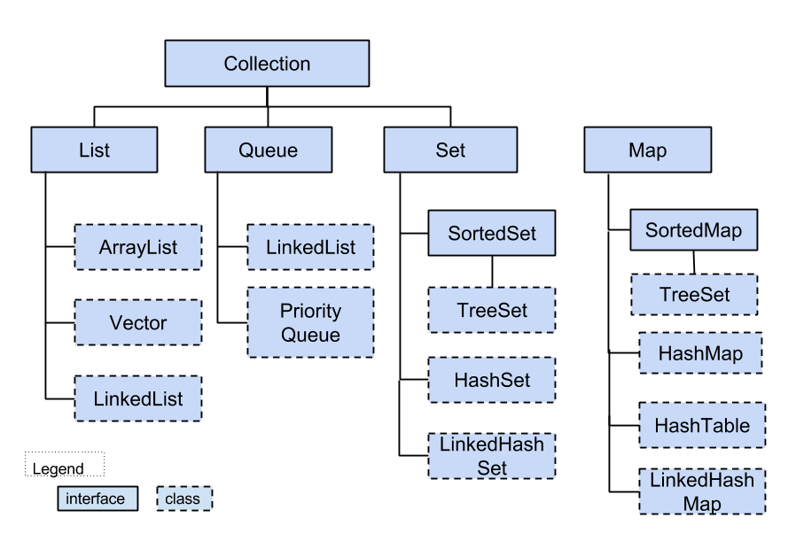
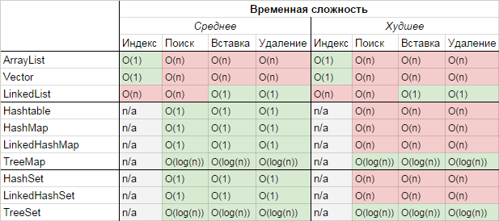

# Java и JVM

## Короткие вопросы, которые часто задают

### Чем отличаются `Optional.orElse` и `orElseGet`?

Java вычисляет аргументы до вызова метода, поэтому `optional.orElse(repository.loadById(id))` вызывает репозиторий даже при непустом `Optional`. В `orElseGet(() -> repository.loadById(id))` запасное значение вычисляется только при пустом `Optional`.

### Что происходит с исключением из задачи `ExecutorService`?

`submit` возвращает `Future`; исключение задачи сохраняется в нём и обычно проявляется при `Future.get()` как `ExecutionException`. Если результат `Future` игнорировать, ошибка может остаться незамеченной. Для задач без результата можно использовать `execute`, но обработку ошибок всё равно нужно продумать (`UncaughtExceptionHandler`, логирование или собственную обёртку). Поток пула обычно продолжает выполнять другие задачи.

## Области памяти JVM

- **Heap** — объекты и массивы; область общая для потоков и управляется сборщиком мусора.
- **Stack каждого потока** — кадры вызовов, локальные переменные и промежуточные значения. Ссылка может находиться в стеке, а сам объект обычно — в куче; JIT может оптимизировать размещение.
- **Metaspace** — метаданные классов в native memory. Статические поля не следует описывать как хранящиеся в Metaspace: значения полей класса связаны с объектом `Class` в куче.
- **Поколения и регионы** (например, young/old у G1) — логическая организация кучи конкретным GC, а не отдельные универсальные области памяти JVM.





### Изменения

#### Java 9
- приватные методы в интерфейсах;
- в `try-with-resources` можно использовать уже объявленные ресурсы: `try (resource)`;
- фабрики `List.of`, `Set.of`, `Map.of`: полученные коллекции неизменяемы; попытка изменить их приводит к `UnsupportedOperationException`.

#### Java 11
- `var` для локальных переменных появилась в Java 10, а не 11;
- методы `String`: `isBlank()`, `repeat()`, `lines()`, `strip()`.

#### Java 12
- `String.transform()`;
- `Collectors.teeing()` объединяет результаты двух downstream-коллекторов. Это не «несколько коллекторов в стриме» вообще.

#### Java 14
- switch expressions с `->` стали постоянной возможностью; в Java 12–13 они были preview.

#### Java 15
- красивое объявление длинной строки с помощью строкового литерала `"""`
- красивое `NullPointerException`

#### Java 16
- `record` — компактный способ объявить класс-носитель данных с компонентами, accessor-методами и сгенерированными `equals`, `hashCode`, `toString`; это не гарантирует глубокой неизменяемости объектов-компонентов;
- pattern matching для `instanceof`: `if (o instanceof String str) ...`;
- `Stream.toList()`. Возвращённый список неизменяемый; это не полная замена `Collectors.toList()`, у которого изменяемость результата не гарантирована контрактом.

#### Java 17 
- `sealed` классы. При объявлении класса разрешает наследоваться только определенным, указанным классам

#### Java 21
- pattern matching для `switch` и record patterns стали постоянными возможностями, например `case String s when s.length() > 4 -> ...`;
- virtual threads стали постоянной возможностью. Они снижают стоимость большого числа блокирующих задач, но не ускоряют CPU-bound вычисления и не отменяют лимиты внешних ресурсов.

#### Java 22
- unnamed variables и patterns стали постоянной возможностью: `_` можно использовать там, где значение намеренно не нужно (например, `catch (NumberFormatException _)`). Требуется соответствующая версия JDK/языкового уровня.

### Функциональные интерфейсы
- `Predicate<T>` — принимает `T`, возвращает `boolean`;
- `Consumer<T>` — принимает `T`, ничего не возвращает;
- `Supplier<T>` — создаёт/возвращает `T` без аргументов;
- `Function<T, R>` — преобразует `T` в `R`;
- `UnaryOperator<T>` — частный случай `Function<T, T>`;
- `BinaryOperator<T>` — принимает два значения одного типа и возвращает значение того же типа.

## Контракты объектов и коллекции

### `equals` и `hashCode`

- `==` для примитивов сравнивает значения, для ссылок — идентичность объектов. `equals` сравнивает логическое равенство согласно реализации класса.
- `equals` должен быть рефлексивным, симметричным, транзитивным и стабильным, пока значимые для сравнения данные не меняются; для `null` он возвращает `false`.
- Если два объекта равны по `equals`, их `hashCode` обязан совпадать. Обратное неверно: коллизии допустимы.
- Если переопределить `equals`, нужно согласованно переопределить `hashCode`. Иначе хеш-коллекции могут не найти логически равный ключ.
- Не меняйте поля, участвующие в `equals`/`hashCode`, пока объект используется как ключ `HashMap`/`HashSet`: запись останется в корзине, выбранной по старому хешу.

### `HashMap`

`HashMap` использует массив корзин: хеш помогает выбрать корзину, а `equals` различает ключи внутри неё. При росте таблица расширяется; ожидаемая стоимость поиска обычно близка к `O(1)`, но зависит от распределения хешей и стоимости `equals`. Порядок обхода не гарантирован.

`HashMap` не потокобезопасен и допускает `null`-ключ и `null`-значения. Для конкурентного доступа используйте `ConcurrentHashMap`; составную логику выполняйте атомарными методами вроде `compute` или `putIfAbsent`, а не отдельными `get` и `put`.

### Generics и PECS

В Java generics в основном реализованы через стирание типов: `List<String>` и `List<Integer>` — разные типы на этапе компиляции, но информация о параметре типа обычно недоступна как отдельный runtime-тип. Поэтому нельзя написать `new T[]`, а `instanceof List<String>` недопустим. Массивы, в отличие от generic-коллекций, проверяют тип компонента во время выполнения.

Generic-типы инвариантны: `List<Integer>` не является `List<Number>`. Wildcard даёт безопасную вариативность:

```java
static <T> void copy(List<? extends T> source, List<? super T> target) {
    for (T value : source) {
        target.add(value);
    }
}
```

**PECS**: `Producer Extends, Consumer Super` — источник читаем через `? extends T`, приёмник записываем через `? super T`. Не добавляйте в `List<? extends T>` произвольный `T`: фактический список может быть, например, `List<Dog>`, а значение — другим наследником `T`.

### Неизменяемые коллекции

- `List.of(...)` создаёт неизменяемую коллекцию и не принимает `null`.
- `Collections.unmodifiableList(list)` — только неизменяемое представление: изменения исходного `list` видны через него.
- Чтобы получить независимый снимок, создайте копию, например `List.copyOf(list)`. Она также не принимает `null`.

Неизменяемая коллекция не гарантирует глубокой неизменяемости её элементов.

### `ArrayList` или `LinkedList`?

`ArrayList` обычно является выбором по умолчанию: быстрый доступ по индексу, амортизированное `O(1)` добавление в конец и хорошая локальность данных. У `LinkedList` доступ по индексу — `O(n)`; вставка/удаление за `O(1)` возможны, только если позиция уже найдена, а узлы и ссылки создают дополнительные затраты памяти. Частая вставка в середину сама по себе не делает `LinkedList` быстрее, если поиск позиции тоже нужен.

### Garbage collectors

- **throughput (пропускная способность)** - Это сколько полезной работы делает приложение за всё время. Если приложение тратит мало времени на сборщик мусора, throughput высокий. Пример: из 100 секунд работы 2 секунды ушли на GC → throughput ≈ 98%.
- **latency (задержки)** - Это насколько долго приложение «зависает» из‑за GC — паузы, которые видит пользователь. Пример: одна пауза 200 ms может испортить отклик даже при хорошем throughput.
- **В чём конфликт?** Часто уменьшение пауз (лучший latency) требует дополнительных фоновых операций или ресурсов, что может немного снизить throughput. И наоборот — максимальный throughput может давать редкие, но длинные паузы.
- Коротко: **throughput** — это «сколько работы сделано», **latency** — это «насколько приложение подвисало». Решение — сначала измерить, затем выбрать настройку/GC под цель (либо меньше пауз, либо больше пропускной способности).

**Инструменты**: Включите лог GC (например, -Xlog:gc*), посмотрите **VisualVM** или **Java Flight Recorder** и метрики отклика (p95/p99).

- **Serial GC** — однопоточный сборщик с низкими накладными расходами; может подходить небольшим приложениям и средам с ограниченными ресурсами. На больших кучах паузы stop-the-world могут быть длительными.
- **Parallel GC** - многопоточный “Throughput” сборщик, целью которого максимизировать пропускную способность приложения, допуская более долгие паузы. Хорошо работает на многоядерных системах, но паузы stop-the-world могут быть большими.
- **CMS** выполнял часть работы конкурентно, но мог фрагментировать кучу; deprecated в Java 9 и удалён в Java 14. Для новых проектов не рассматривается.
- **G1 GC** — региональный сборщик и default-сборщик в современных серверных конфигурациях HotSpot. Цель `-XX:MaxGCPauseMillis` — эвристическая, а не гарантия верхней границы паузы. Поведение зависит от JDK, размера heap и нагрузки.
- **Shenandoah** и **ZGC** нацелены на низкие паузы и выполняют значительную часть работы конкурентно. Доступность и статус зависят от дистрибутива JDK; ZGC стал production-ready в OpenJDK 15, а generational ZGC доступен начиная с JDK 21. Низкие паузы не бесплатны и не означают отсутствия влияния GC на latency/throughput.

Критерии выбора: **потребление ресурсов, пропускная способность, задержки**

### WeakReference и SoftReference
Упоминается в контексте сборки мусора. 

`SoftReference` может быть очищена при нехватке памяти, однако момент очистки не является предсказуемой политикой вытеснения. Для прикладного кеша обычно предпочтительнее ограниченная библиотека с явными TTL/лимитами.

`WeakReference` позволяет сборщику очистить объект при следующем подходящем цикле GC, если на него не осталось сильных ссылок; точный момент не гарантируется.

### Профилирование 
https://proselyte.net/load-testing-and-jvm-profiling/#java-app-profiling
Когда нагрузочное тестирование выявило проблемы (например, медленный эндпоинт, высокое время отклика или ошибки), на сцену выходит профилирование. **Профилирование** – это динамический анализ программы, позволяющий замерить, сколько ресурсов потребляют разные части кода (время выполнения методов, объем памяти под объекты, частота вызовов функций и т.п.). Цель профилирования – помочь оптимизации программы, указав узкие места в коде или конфигурации.

Существует два основных подхода к профилированию:
- **Инструментальное профилирование (instrumenting)** – когда в код внедряются специальные инструкции для сбора данных (например, подсчет времени входа/выхода из метода). Это может делать либо сам разработчик (вручную, или с помощью AOP), либо профилировщик на этапе загрузки класса. Инструментирование дает точные измерения конкретных методов, но имеет существенный overhead и может влиять на временные характеристики программы. 
- **Сэмплирующее профилирование (sampling)** – когда профилировщик периодически (например, каждые 10 мс) опрашивает потоки приложения и собирает текущие стеки вызовов. На основе множества выборок строится статистическая картина нагрузки по методам. Этот подход менее нагружает приложение (т.к. не каждое событие логируется, а лишь периодически), но результаты могут быть неточными в деталях (особенно для очень кратковременных функций). Тем не менее sampling-профилировщики широко применяются для поиска CPU hot spots, т.к. дают хорошее приближение с минимальным влиянием.

В контексте Spring Boot приложений и JVM профилирование охватывает несколько областей: 
- **CPU профилирование (Execution Profiling)** – измерение, какие методы/классы потребляют основное время CPU. Помогает найти неэффективный код, тяжелые алгоритмы. Например, можно обнаружить, что 40% CPU уходит в метод обработки JSON или в расчет каких-то данных – сигнал задуматься об оптимизации или кешировании результата.
- **Профилирование памяти (Memory Profiling)** – отслеживание использования памяти: какие объекты занимают много места, как растет heap, сколько объектов создается и не освобождается (возможные утечки). Анализируя распределение объектов в heap dump, можно найти, например, что остаются висеть сессии или кэш не очищается, или неправильная коллекция используется, растущая безгранично.
- **Анализ GC** – хотя сборка мусора автоматизирована, профилирование позволяет понять, как часто происходят GC, сколько времени они занимают, сколько памяти освобождается. Это можно делать по логам GC либо через специальные события (Flight Recorder собирает события GC). Оптимизация может включать тюнинг параметров GC или выбор другого алгоритма.
- **Профилирование потоков (Thread Profiling)** – наблюдение за состоянием потоков: сколько их, чем заняты, нет ли взаимоблокировок. Например, профайлер может показать, что потоки долго стоят в ожидании на монитор (блокировка) или, скажем, все 200 потоков Tomcat заняты и ждут ответа от внешнего веб-сервиса – это ценная информация для оптимизации (может, нужно увеличить пул или ограничить внешние вызовы). Инструменты позволяют делать thread dump и даже визуализировать, сколько времени поток провел в каком состоянии (Running, Waiting, Blocked).

**Практика**: сначала измерьте allocation rate, паузы, задержки p95/p99 и причину Full GC с помощью GC-логов (`-Xlog:gc*`) и JFR. G1 — разумная отправная точка для многих приложений HotSpot, но default зависит от JDK и среды. Сравнивайте сборщики на реалистичной нагрузке и проверяйте доступность конкретной реализации в выбранном дистрибутиве.

## Вопросы на собеседовании

### Чем `record` отличается от обычного класса?

Record выражает модель данных и генерирует стандартные методы по компонентам. Компоненты final, но ссылки на изменяемые объекты не делают объект глубоко неизменяемым; при необходимости нужна защитная копия.

### Почему `Stream.toList()` не всегда заменяет `Collectors.toList()`?

`Stream.toList()` возвращает неизменяемый список. Контракт `Collectors.toList()` не обещает конкретную реализацию или изменяемость, поэтому код, которому нужен изменяемый список, должен явно запросить её, например через `Collectors.toCollection(ArrayList::new)`.

### Почему при переопределении `equals` нужно переопределять `hashCode`?

`HashMap` и `HashSet` сначала ищут корзину по хеш-коду, а затем проверяют `equals`. Если равные объекты имеют разные хеш-коды, поиск или проверка дубликата могут не найти уже добавленный объект.

### Что означает PECS в generics?

`extends` используют для параметра, из которого читают значения; `super` — для параметра, в который их записывают. Например, копирование из `List<? extends T>` в `List<? super T>` безопасно для типа `T`.

### Почему `List<Integer>` нельзя передать туда, где ожидается `List<Number>`?

Generics инвариантны. Иначе метод, принимающий `List<Number>`, мог бы добавить туда `Double` и нарушить тип исходного `List<Integer>`. Для чтения применяют `List<? extends Number>`, для добавления чисел — `List<? super Integer>`.

### Когда выбирать `ArrayList`, а когда `LinkedList`?

Обычно `ArrayList`: он эффективен для индексного доступа и последовательного обхода. `LinkedList` имеет смысл только при подходящем профиле операций; вставка в середину не становится `O(1)`, если до нужной позиции ещё требуется дойти.

### Почему нельзя выбирать GC по одной цифре паузы?

Нужно учитывать распределение задержек приложения, throughput, использование CPU и памяти, скорость выделения объектов и требования к heap. Целевые значения пауз — подсказка эвристике, не SLA.


