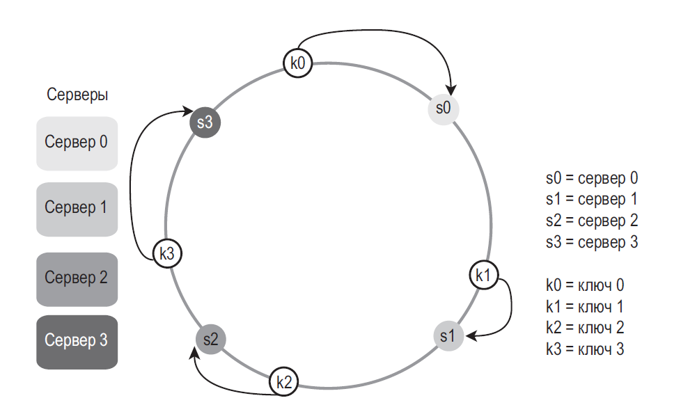
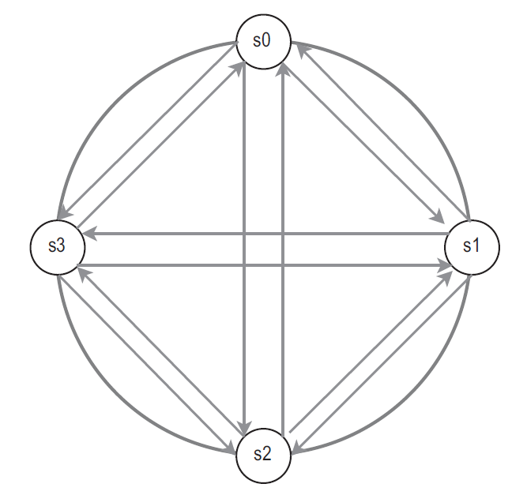
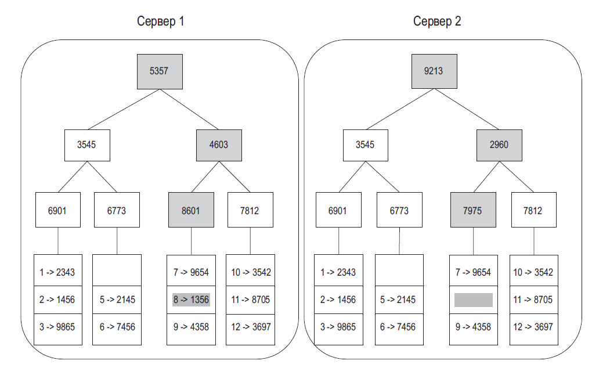
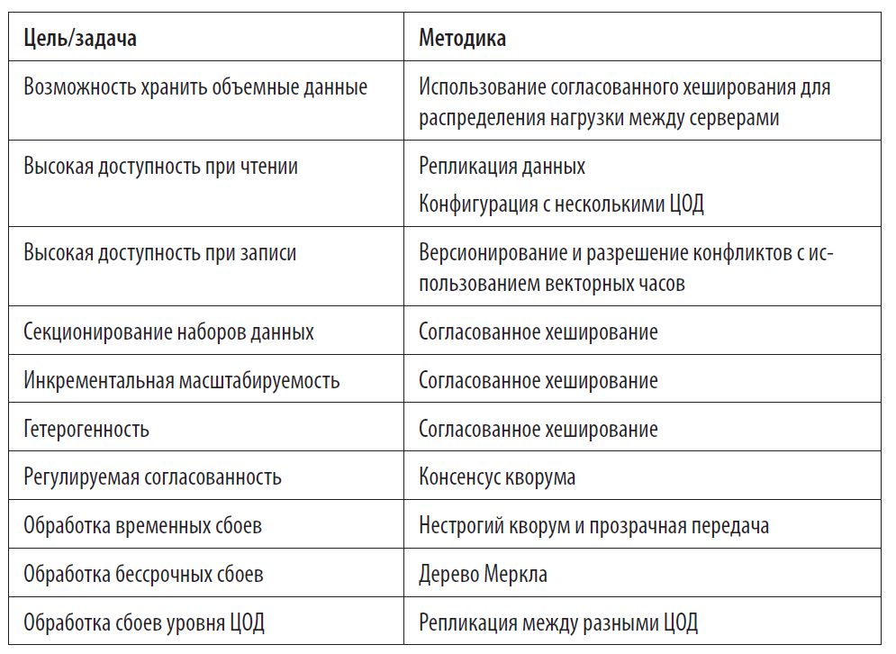

### База
#### Шаг 1: понять задачу и определить масштаб решения
**Сначала согласуйте требования и ожидаемый масштаб** — не начинайте проектирование, пока не выяснили, что именно строим.
Вот список вопросов, с которых можно начать:
- Какие именно возможности мы будем реализовывать?
- Сколько пользователей у нашего продукта?
- Как скоро ожидается наращивание мощностей? Какой масштаб планируется через 3 месяца, полгода, год?
- Как выглядит технологический стек компании? Какие существующие сервисы можно применить для упрощения архитектуры?

#### Шаг 2: предложить общее решение и получить согласие
**Обсуждайте архитектуру совместно с интервьюером и проговаривайте свои допущения.**
Очень желательно в ходе этого процесса наладить совместную работу
- Предложите начальный план архитектуры. Поинтересуйтесь мнением интервьюера. Относитесь к нему как к члену своей команды, с которым вы вместе работаете. Хорошие интервьюеры зачастую любят поговорить и поучаствовать в решении задачи
- Нарисуйте на доске или бумаге блок-схемы с ключевыми компонентами, такими как клиенты (мобильные/браузерные), API-интерфейсы, веб-серверы, хранилища данных, кэши, CDN, очереди сообщений и т. д.
- Выполните приблизительные расчеты, чтобы понять, соответствует ли ваше решение масштабу задачи. Рассуждайте вслух. Прежде чем что-то считать, пообщайтесь с интервьюером
- По возможности пройдитесь по нескольким конкретным сценариям использования. Это поможет вам сформировать общую архитектуру и, скорее всего, обнаружить крайние случаи, о которых вы еще не думали
- Следует ли на этом этапе обозначать конечные точки API-интерфейса и схему базы данных? Это зависит от задачи. Если вас просят спроектировать что-то масштабное, такое как поиск Google, то лучше не углубляться настолько сильно. Если же речь идет о серверной части многопользовательской игры в покер, эти аспекты вполне можно указать. Общайтесь с интервьюером.

#### Шаг 3: глубокое погружение в проектирование
**Углубляйтесь в те области, которые согласовали с интервьюером**, а не детализируйте всю систему одинаково.
На этом этапе вы и интервьюер достигли следующих целей:
- согласовали общие требования и будущий масштаб
- начертили примерную схему архитектуры
- узнали мнение интервьюера о вашем общем решении
- получили какое-то базовое представление о том, на каких областях нужно сосредоточиться при подробном проектировании (исходя из того, что ответил интервьюер).

#### Шаг 4: подведение итогов
- Интервьюер может попросить вас **обозначить узкие места системы и обсудить потенциальные улучшения**. **Никогда не утверждайте, что ваше решение идеальное.** Всегда можно что-то улучшить. Это отличная возможность продемонстрировать свое критическое мышление и оставить о себе хорошее впечатление.
- Возможно, стоит провести краткий обзор вашей архитектуры, особенно если вы предложили несколько решений. Это позволит интервьюеру освежить память, что может пригодиться после длинного собеседования.
- Будет интересно поговорить о внештатных ситуациях, таких как поломка серверов, разрыв сети и т. д.
- Стоит затронуть эксплуатационные вопросы. Как вы отслеживаете метрики и журналы ошибок? Как выкатывается система?
- Проведение следующего этапа масштабирования — тоже весьма интересная тема. Например, если ваша текущая архитектура поддерживает 1 миллион пользователей, какие изменения нужно внести, чтобы увеличить эту цифру до 10 миллионов?
- Если еще остается время, предложите дальнейшие улучшения

#### Время, выделяемое на каждый этап
Примерные расчеты: 
- Шаг 1. Понять задачу и определить масштаб: 3–10 минут.
- Шаг 2. Предложить общее решение и получить одобрение: 10–15 минут.
- Шаг 3. Подробное проектирование: 10–25 минут.
- Шаг 4. Подведение итогов: 3–5 минут.

### Степени двойки
В оценках полезно быстро оперировать степенями двойки. Байт — 8 бит; ASCII-символ кодируется одним байтом в ASCII/UTF-8, но произвольный Unicode-символ может занимать несколько байт. Не путайте десятичные единицы (1 kB = 1000 B) и двоичные (1 KiB = 1024 B).

| Степень | Примерное значение | Полное название | Сокращенное обозначение |
|---------|--------------------|-----------------|-------------------------|
| Степень | Двоичный объём | Единица |
|---|---:|---|
| 10 | 1 024 | 1 KiB |
| 20 | ~1 миллион | 1 MiB |
| 30 | ~1 миллиард | 1 GiB |
| 40 | ~1 триллион | 1 TiB |
| 50 | ~1 квадриллион | 1 PiB |

### ПОКАЗАТЕЛИ ЛАТЕНТНОСТИ

нс = наносекунда, мкс = микросекунда, мс = миллисекунда

* 1 нс = 10^-9 секунд
* 1 мкс = 10^-6 секунд = 1000 нс
* 1 мс = 10^-3 секунд = 1000 мкс = 1 000 000 нс

| Название операции                                    | Время                   |
|------------------------------------------------------|-------------------------|
| Обращение к кэшу L1                                  | 0,5 нс                  |
| Ошибочное предсказание перехода                      | 5 нс                    |
| Обращение к кэшу L2                                  | 7 нс                    |
| Блокирование/разблокирование мьютекса                | 100 нс                  |
| Обращение к основной памяти                          | 100 нс                  |
| Сжатие 1 Кб с помощью Zippy                          | 10 000 нс = 10 мкс      |
| Отправка 2 Кб по сети 1 Гбит/с                       | 20 000 нс = 20 мкс      |
| Последовательное чтение из памяти 1 Мб               | 250 000 нс = 250 мкс    |
| Перемещение пакета туда и обратно внутри одного ЦОД  | 500 000 нс = 500 мкс    |
| Время поиска по диску                                | 10 000 000 нс = 10 мс   |
| Последовательное чтение 1 Мб из сети                 | 10 000 000 нс = 10 мс   |
| Последовательное чтение 1 Мб с диска                 | 30 000 000 нс = 30 мс   |
| Передача пакета из Калифорнии в Нидерланды и обратно | 150 000 000 нс = 150 мс |

Это ориентировочные значения из иллюстративной модели, а не SLA или константы: задержка зависит от оборудования, сети, размера пакета, нагрузки и числа hops. Проверяйте актуальные измерения своего окружения; сетевой RTT и bandwidth — разные характеристики.

* **Память быстрая, а диск медленный**;
* по возможности следует избегать поиска по диску;
* простые алгоритмы сжатия отличаются высокой скоростью;
* прежде чем отправлять данные по интернету, их по возможности нужно сжимать;
* центры обработки данных обычно находятся в разных регионах, и **передача информации между ними занимает время**.

### ПОКАЗАТЕЛИ ДОСТУПНОСТИ

Доступность измеряют за заданное окно и по выбранному критерию (успешный ответ, latency, сценарий). Бюджет простоя ниже — ориентир для непрерывного временного измерения; 100% за конечный период не означает, что сервис никогда не откажет.

| Доступность | Суточный простой    | Недельный простой   | Месячный простой | Годичный простой |
|-------------|---------------------|---------------------|------------------|------------------|
| 99 %        | 14,40 минуты        | 1,68 часа           | 7,31 часа        | 3,65 дня         |
| 99,9 %      | 1,44 минуты         | 10,08 минуты        | 43,83 минуты     | 8,77 часа        |
| 99,99 %     | 8,64 секунды        | 1,01 минуты         | 4,38 минуты      | 52,60 минуты     |
| 99,999 %    | 864,00 миллисекунды | 6,05 секунды        | 26,30 секунды    | 5,26 минуты      |
| 99,9999 %   | 86,40 миллисекунды  | 604,80 миллисекунды | 2,63 секунды     | 31,56 секунды    |

### ПРИМЕР: ОЦЕНКА ТРЕБОВАНИЙ

Предположения:

- 300 млн пользователей в месяц;
- 50% из них активны ежедневно (DAU = 150 млн);
- каждый публикует в среднем 2 записи в день;
- медиа размером в среднем 1 MB прикреплено к 10% записей;
- retention — 5 лет.

Оценка:

- публикаций в день: `150 млн × 2 = 300 млн`;
- средний write rate: `300 млн / 86 400 ≈ 3 500 записей/с`;
- если для грубой оценки предположить peak factor 2, пик ≈ `7 000 записей/с`; реальный профиль нужно измерить/уточнить;
- медиа: `300 млн × 10% × 1 MB ≈ 30 TB/день`;
- за 5 лет: `30 TB × 365 × 5 ≈ 55 PB` сырого медиа в десятичных единицах.

Это оценка только медиа без текста, метаданных, реплик, backup, thumbnails/transcoding и сжатия. Нагрузку чтения считайте отдельно по read/write ratio; среднее не заменяет peak и burst.

## СОГЛАСОВАННОЕ ХЕШИРОВАНИЕ

Для обеспечения горизонтального масштабирования запросы/данные должны распределяться между серверами эффективно и равномерно. Для этого зачастую используется согласованное хеширование

Простое распределение `serverIndex = hash(key) % N` легко реализовать, но при изменении `N` большая часть ключей переезжает. Согласованное хеширование размещает узлы и ключи на кольце и при изменении состава обычно перемещает только часть ключей; альтернативой может быть rendezvous hashing.

При modulo hashing добавление/удаление узла меняет остаток и часто переназначает ключи. У consistent hashing перемещается меньшая доля ключей, но равномерность не гарантирована автоматически и зависит от количества/веса виртуальных узлов, распределения нагрузки и hot keys.

### Виртуальные узлы
Виртуальные узлы дают каждому физическому серверу несколько позиций на кольце и обычно уменьшают разброс распределения. Больше виртуальных узлов требуют больше metadata и не решают hot-key сами по себе; число подбирают нагрузочным тестом.

### Согласованность

Так как данные реплицируются по нескольким узлам, чтения и записи могут использовать quorum. Это не всегда консенсус-протокол и не универсальная гарантия линейризуемости; сначала определите модель конкретного хранилища.
- **N** = количество реплик.
- **W** = кворум **записи** размера W. Операция записи считается успешной, только если она подтверждена W репликами.
- **R** = число реплик, от которых ждут ответ при чтении.

Как сконфигурировать N, W и R для наших задач? Вот несколько возможных вариантов:
- если **R = 1 и W = N**, система оптимизирована для **быстрого чтения**;
- если **W = 1 и R = N**, система оптимизирована для **быстрой записи**;
- если **W + R > N**, кворумы пересекаются при заданных предположениях о размещении и ответах реплик;
- пересечение само по себе не гарантирует линейризуемость: важны разрешение конфликтующих/конкурентных записей, версии, failover и конкретная реализация quorum/sloppy quorum.

### Модели согласованности
Модель согласованности — еще один важный фактор, который следует учитывать при проектировании хранилища типа «ключ–значение». Она определяет степень согласованности данных и имеет широкий спектр разновидностей.
- **Линейризуемость**. Операции выглядят атомарными и соблюдают real-time порядок: чтение после завершившейся записи видит её результат. Это не требует обязательного подтверждения от всех реплик, но требует достаточной координации согласно протоколу.
- **Слабая согласованность**. Последующие _операции чтения могут и не вернуть самое последнее значение_.
- **Согласованность в конечном счёте**. Если обновления прекратятся и система восстановит обмен, реплики в итоге сойдутся; срок сходимости и разрешение конфликтов нужно определить отдельно.

### Устранение несогласованности: версионирование

**Векторные часы** — отображение `nodeId → counter`, связанное с версией данных. Сравнение векторов показывает причинный порядок или конкурентность версий; при конфликте требуется правило слияния/разрешения, а не просто выбор «большей».

### Обнаружение сбоев

Более оптимальное решение состоит в использовании децентрализованных методов обнаружения сбоев, таких как протокол сплетен (gossip protocol). Он работает следующим образом.

- Каждый узел хранит список узлов-участников, состоящий из идентификаторов и счетчиков пульсации.
- Каждый узел периодически инкрементирует счетчик пульсации.
- Каждый узел периодически шлёт пульс группе узлов, которые могут передавать сведения дальше.
- При получении пульса узлы обновляют список участников до последней версии.
- Если счётчик пульсации не увеличивается в течение таймаута, узел помечают подозреваемым в отказе; сетевой раздел может дать ложное подозрение.

Для обнаружения несогласованности и минимизации объема передаваемых данных используется **дерево Меркла**

**Дерево Меркла** строит хеши листьев из блоков данных, а внутренние узлы — из хешей потомков с однозначным кодированием. Сравнение корневых хешей помогает эффективно находить различающиеся части больших наборов данных; это не механизм консенсуса и не шифрование.

## Вопросы на собеседовании

### Как оценивать QPS и хранилище?

Сначала отделить DAU/MAU, число действий на пользователя, среднюю скорость, peak factor и read/write ratio. Для хранения умножить объём записи на retention, затем отдельно учесть индексы, репликацию, резервные копии, сжатие и рост. Явно проговаривайте допущения и проверяйте чувствительность оценки к ним.

### Что даёт consistent hashing?

При изменении числа узлов он обычно уменьшает долю ключей, которые нужно переназначить, по сравнению с `hash(key) % N`. Он не гарантирует равномерность нагрузки и не решает hot key; нужны виртуальные узлы/веса и отдельная стратегия для горячих ключей.

### Даёт ли `R + W > N` строгую согласованность?

Нет, не само по себе. Это условие пересечения quorum при определённых предположениях; требуются также корректный порядок/версионирование записей, подходящий read-repair/failover и поддержка гарантий конкретной СУБД.
