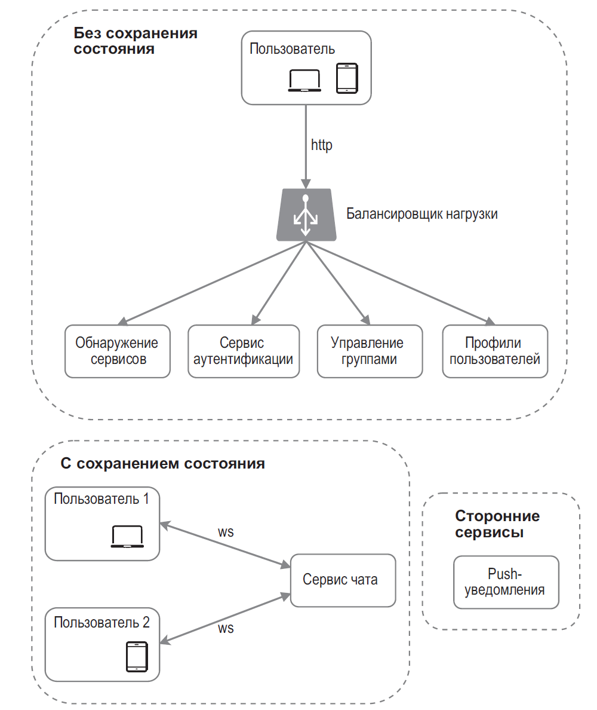
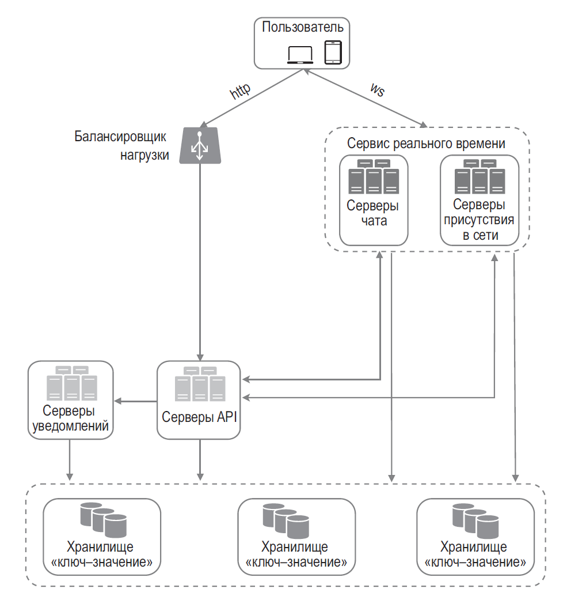

## Проектирование чата

### Сначала уточнить требования

- Личные или групповые чаты, размер группы, вложения, поиск и редактирование/удаление?
- Нужны ли история, несколько устройств, offline-доставка, read receipts и typing/presence?
- Какой порядок нужен: глобальный или только внутри беседы? Какая допустима задержка?
- Какие требования к приватности, retention, шифрованию и восстановлению?

Для чата обычно важны надёжная запись сообщения и порядок внутри одной беседы; присутствие и typing-индикаторы могут быть best-effort. «Exactly once» при доставке клиенту не предполагается: используют повторную доставку и дедупликацию по `messageId`.

### Транспорт и компоненты

Для двунаправленного канала подходят **WebSocket**; **SSE** проще, если серверу достаточно отправлять поток событий, а клиент пишет через HTTP; long polling совместимее с простой инфраструктурой, но создаёт больше запросов/соединений. Ни один транспорт сам по себе не решает хранение, подтверждение доставки и восстановление после разрыва.

- **Connection gateway** держит WebSocket-соединения, аутентифицирует клиентов и маршрутизирует входящие/исходящие сообщения. Нужны heartbeats, reconnect с backoff и лимиты соединений.
- **Chat/message service** проверяет членство и права, присваивает ID/sequence и сохраняет сообщение.
- **Основная БД** — источник истины для сообщений и membership. Выбор между SQL и распределённым хранилищем зависит от запросов, объёма, транзакций и партиционирования; ключом часто служит `conversationId`.
- **Broker/event stream** доставляет событие между узлами и обновляет подключённые gateway. Outbox связывает запись сообщения с публикацией события.
- **Presence** хранит эфемерные lease/heartbeat с TTL; статус online приблизительный и не должен влиять на сохранность сообщений.
- **Push provider** уведомляет offline-устройства; push — best-effort сигнал, а не источник истории.

### Поток сообщения и отказные сценарии

1. Клиент отправляет сообщение с уникальным `messageId` и ожидаемым `conversationId`.
2. Сервис проверяет право отправки и атомарно сохраняет сообщение (и outbox-событие); ответ отправителю означает подтверждённую запись, а не доставку всем получателям.
3. Relay публикует событие; consumer/gateway может получить его повторно, поэтому делает дедупликацию.
4. Подключённые устройства получают событие и подтверждают доставку/прочтение отдельно, если это нужно продукту. Пропущенное устройство синхронизируется из истории по cursor/sequence.
5. При недоступности broker outbox накапливается и повторяется; при недоступности БД запись не подтверждается. Очереди и retries ограничивают нагрузку, poison events отправляют в DLQ с мониторингом.

Для упорядочивания используют sequence в пределах беседы или порядок partition по `conversationId`. Глобальная последовательность дорога и обычно не нужна. Горячая большая группа может перегрузить одну partition или fanout; варианты — fanout-on-read, батчирование и выделение hot conversations.

### Компромиссы

- **Fanout-on-write** быстро читает ленту получателя, но публикация в огромную группу создаёт write amplification.
- **Fanout-on-read** дешевле при отправке в большую группу, но чтение агрегирует данные и может быть медленнее.
- Шардирование по беседе упрощает порядок и запросы истории, но горячая беседа ограничена ёмкостью одного shard/partition.
- Шифрование end-to-end повышает приватность, но усложняет поиск, модерацию и восстановление ключей.

**Вопрос:** как не потерять сообщение при сбое после записи в БД, но до публикации?
**Ответ:** записать сообщение и outbox-event одной транзакцией, публиковать асинхронно с повторами, а на стороне получателя дедуплицировать по стабильному ID.
