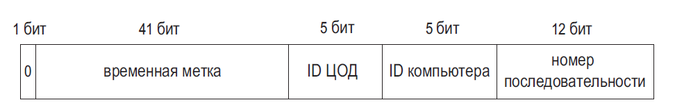

## Проектирование распределённого генератора ID

Перед выбором алгоритма уточните: ID должен быть уникальным глобально или только внутри таблицы, сортируемым по времени, непредсказуемым, компактным? Нужны ли выдача без координации, работа offline и заданный throughput?

### Snowflake-подобный 64-битный ID

Один распространённый формат:

```text
0 | timestamp (41 бит) | workerId (10 бит) | sequence (12 бит)
```

- Старший бит оставляют нулём, чтобы положительный ID помещался в знаковый `long`.
- `timestamp` — число миллисекунд от согласованной пользовательской эпохи, не обязательно Unix epoch.
- `workerId` уникален среди активных процессов. Его выдачу нужно координировать (например, lease/конфигурацией); один и тот же ID на двух узлах создаёт коллизии.
- `sequence` увеличивается для каждого ID данного worker в одну миллисекунду и сбрасывается при смене миллисекунды.

При 12 битах sequence теоретический лимит — 4096 ID на worker за миллисекунду. Если он исчерпан, генератор должен ждать следующую миллисекунду или вернуть ограниченную ошибку; нельзя молча повторно использовать sequence. 41 бит миллисекунд покрывает около 69,7 лет от выбранной эпохи.



### Порядок, часы и отказоустойчивость

При одинаковом timestamp ID одного worker упорядочены sequence, но ID разных workers не задают строгий глобальный порядок создания. Часы узла могут корректироваться назад: стратегия должна приостановить выдачу, дождаться прежнего времени или перейти в контролируемый отказ; продолжение с повторяющимся timestamp может породить дубликат. Отслеживайте clock drift и корректно выделяйте worker ID после перезапуска.

Временная составляющая облегчает сортировку, но делает ID частично предсказуемым и раскрывает примерное время создания. Если непредсказуемость важна, рассмотрите случайные UUID/UUIDv7 или отдельную непрогнозируемую публичную ссылку.

### Альтернативы и компромиссы

- **DB sequence/identity** проста и строго уникальна в пределах настроенной БД, но централизует выдачу и может стать зависимостью/узким местом.
- **UUIDv4** не требует координации и трудно угадывается, но занимает больше места и хуже упорядочивается по времени.
- **UUIDv7** включает временную компоненту и удобен для сортировки; доступность генератора зависит от платформы, а уникальность/качество случайной части всё равно нужно обеспечить.
- Snowflake-подобный генератор компактен и высокопроизводителен, но требует дисциплины с часами, worker ID и форматом эпохи.

**Вопрос:** гарантирует ли Snowflake глобальный порядок?
**Ответ:** нет. Он даёт временную составляющую и локальный sequence на worker; разные узлы имеют рассинхронизацию часов и могут выпускать ID в одном миллисекундном окне.
