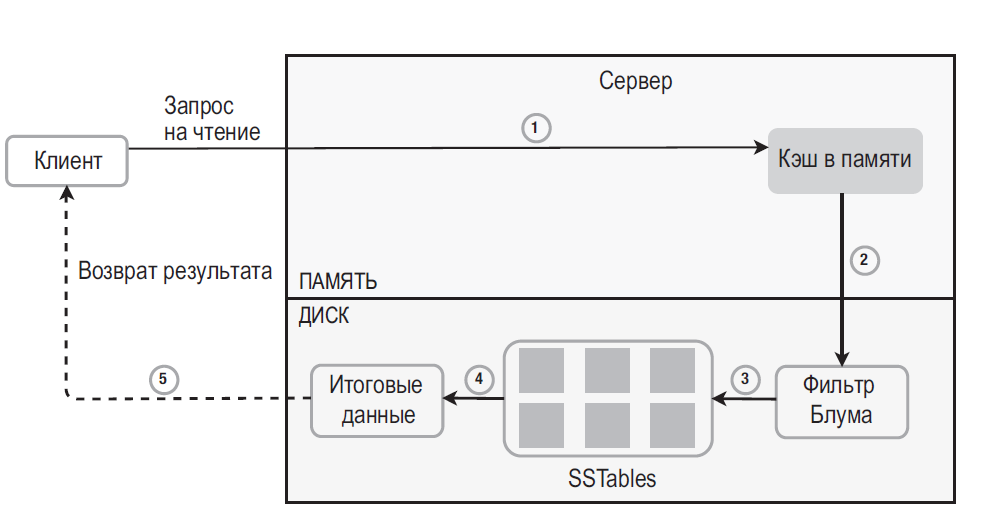

## Проектирование key-value-хранилища

### Требования и модель данных

Уточните операции (`get`, `put`, `delete`, range scan), размер/рост данных, read/write ratio, latency, durability, replication, консистентность, TTL, размер значения и модель отказов. Простое key-value API не означает отсутствие транзакций, индексов или схемы; это выбранная граница интерфейса.

### LSM-дерево: путь записи и чтения

LSM-подход эффективен для интенсивной записи и последовательного I/O:

1. Запись сначала попадает в WAL (для восстановления) и в memtable в памяти.
2. При достижении порога memtable сбрасывается на диск в неизменяемую отсортированную таблицу — **SSTable**.
3. Фоновые compaction-процессы объединяют SSTable, удаляют устаревшие версии и tombstone, ограничивая число файлов/слоёв.
4. Чтение проверяет memtable и подходящие SSTable от новых к старым; нужная строка может находиться в нескольких файлах, поэтому без индекса/кеша чтение дороже.

**Bloom filter** — вероятностная структура для проверки принадлежности: отрицательный ответ означает, что ключа в наборе точно нет; положительный может быть ложным и требует чтения SSTable. Bloom filter сам не возвращает значение и не допускает false negative при корректной реализации.

### Альтернативы и узкие места

- **B-tree** хранит отсортированные страницы и обычно удобен для чтения диапазонов/обновления записей; случайные обновления могут давать больше случайного I/O.
- **LSM** хорошо справляется с последовательными записями, но compaction создаёт write amplification, занимает CPU/I/O и может ухудшать tail latency.
- Кеш ускоряет горячие чтения, но требует политики eviction и не является источником истины.
- Репликация улучшает доступность, но нужно определить sync/async режим, quorum и поведение при потере узла. Асинхронная реплика может отставать и потерять последние записи при failover.
- Шардирование масштабирует ёмкость, но усложняет routing, multi-key операции, rebalance и hot-key handling.

### Отказы и гарантии

WAL/flush policy определяет, какие подтверждённые записи переживут падение процесса/машины. Задайте RPO, проверяйте восстановление после crash и контролируйте место на диске, количество SSTable, compaction backlog и latency. Для критичных данных нужны реплики и проверенные backup; ни Bloom filter, ни кеш этого не заменяют.

**Вопрос:** зачем нужны tombstone?
**Ответ:** в LSM физически удалить ключ из всех старых SSTable сразу дорого. Tombstone скрывает старые значения при чтении, пока compaction безопасно не удалит их; слишком долгое хранение tombstone увеличивает стоимость чтения и риск некорректной очистки при репликации.
