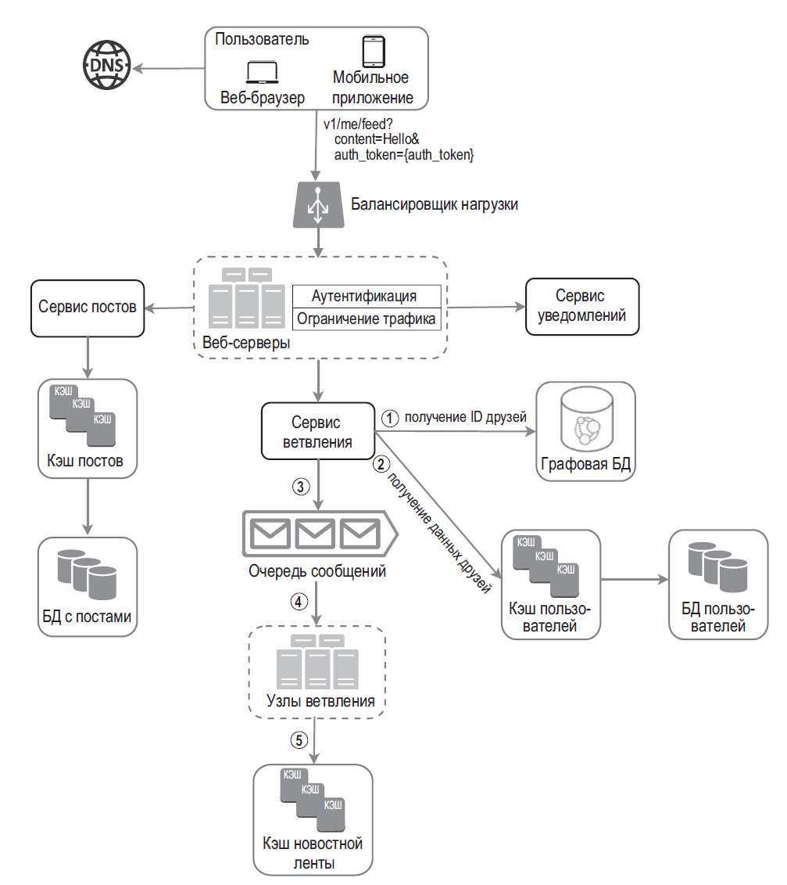
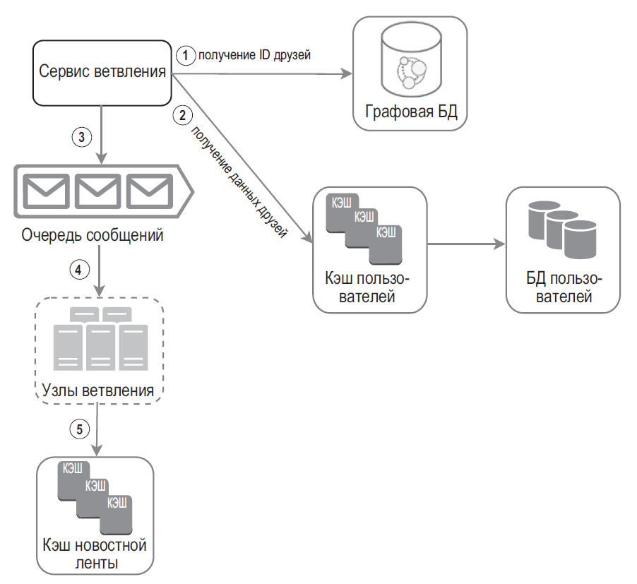
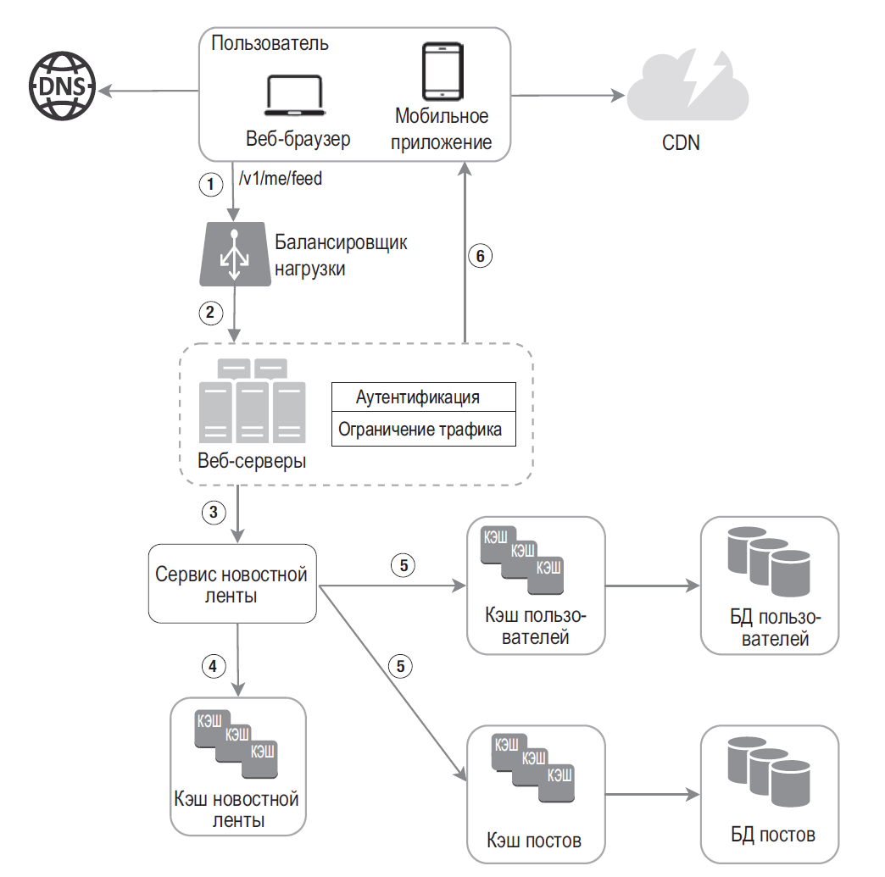
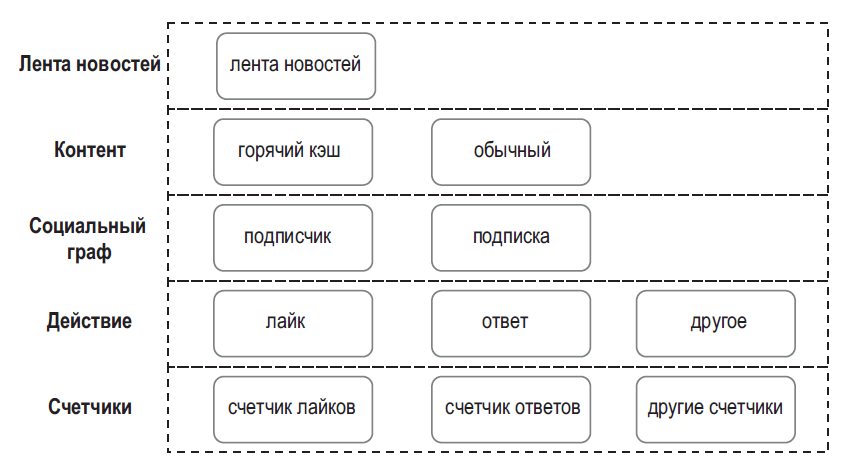

## Проектирование новостной ленты

### Требования

Уточните, лента хронологическая или ранжированная, публичная или приватная, сколько подписок/постов у пользователей, как быстро новый пост должен появиться, нужен ли edit/delete и какое окно устаревания допустимо. Важны read/write QPS, размер страницы и целевой p95/p99.

### Модель fanout

#### Fanout-on-write (push)

При публикации сервис получает подписчиков автора и добавляет `postId` в их feed-списки/материализованные представления.

- Быстрое чтение: для типичного пользователя достаточно выбрать последние ID из готовой ленты.
- Цена — write amplification: один пост популярного автора может требовать миллионов вставок.
- Worker-ы читают подписчиков страницами, проверяют privacy/mute/block и отправляют задания в очередь. Обработку делайте идемпотентной, ограничивайте размер fanout и отслеживайте lag.

#### Fanout-on-read (pull)

При чтении ленты сервис получает недавние посты авторов, на которых подписан пользователь, объединяет и ранжирует их.

- Запись дешевле, но чтение может требовать большого числа запросов и дорогого merge.
- Подходит для авторов с огромным числом подписчиков или низкой активностью читателя.

### Гибридная архитектура

Для обычных авторов можно использовать push, а для celebrity/hot accounts — pull при чтении. Гибрид экономит массовую запись, но требует merge двух источников, дедупликации и согласованного ранжирования. Согласованное хеширование само по себе не устраняет fanout и hotspot; нужны лимиты, batching, выделение горячих ключей и измерения.

Путь чтения: API получает candidate `postId` из materialized feed и/или pull-источников, загружает карточки постов/авторов пакетно, повторно проверяет доступность и privacy, затем применяет ranking и возвращает cursor-based страницу. Кешируйте данные разумно; feed хранит ID, а контент/аватары могут находиться в отдельных хранилищах.

### Данные, согласованность и отказы

- Feed — список/индекс ID постов, ограниченный окном хранения.
- Post store — источник истины для текста/медиа и статуса удаления.
- Social graph — связи подписки; для этого не обязательно нужна graph DB, реляционные таблицы могут быть достаточны.
- Счётчики реакций часто обновляются асинхронно и допускают eventual consistency.

Очереди дают повторную доставку, поэтому fanout-worker должен быть идемпотентным. При сбое materialized feed восстанавливают повторным проигрыванием событий или регенерацией; при lag UI может показывать старую ленту, но удалённый/закрытый пост нужно фильтровать по политике приватности. Пагинация по offset нестабильна при новых публикациях; cursor по `(createdAt, postId)` устойчивее.

### Вопросы на собеседовании

#### Что делать с автором-миллионником?

Не выполнять fanout всем подписчикам в критическом пути публикации. Использовать pull/гибридную модель, очередь и batching; стоимость чтения и свежесть ленты становятся компромиссом.

#### Почему feed обычно хранит ID, а не полные посты?

Это уменьшает дублирование и позволяет обновлять контент централизованно. Цена — дополнительные batched reads и необходимость переживать пропуски/удаления; денормализация может быть оправдана измеренным latency.
