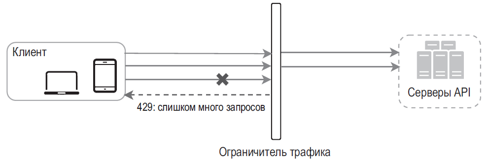
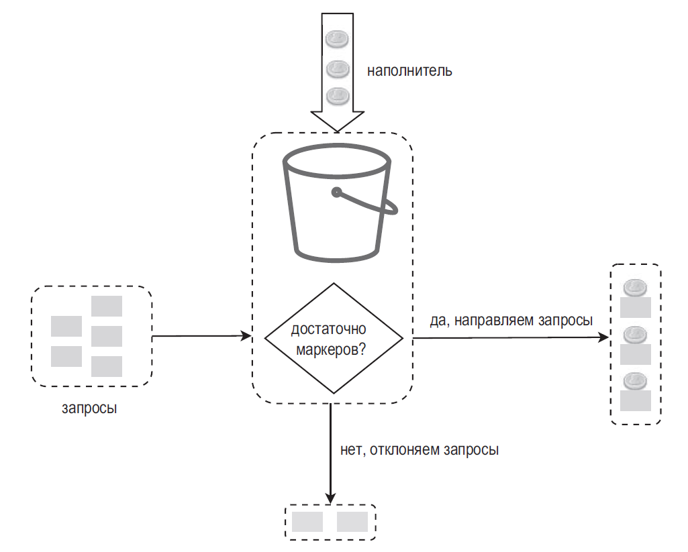
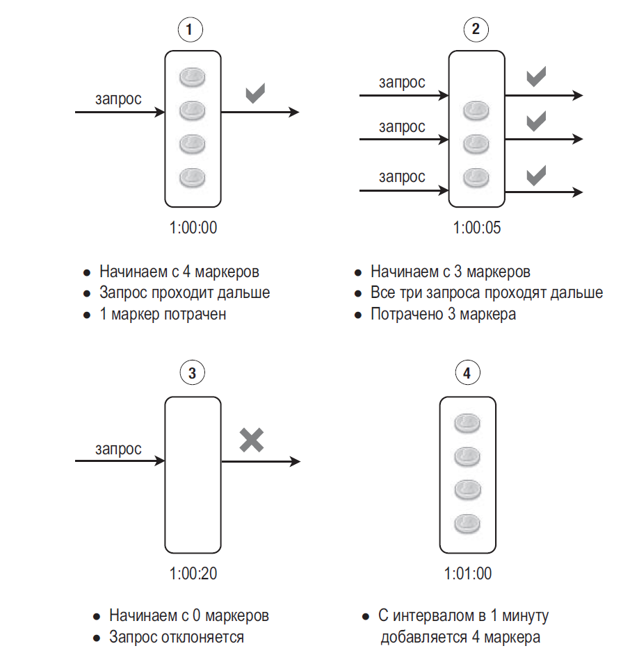
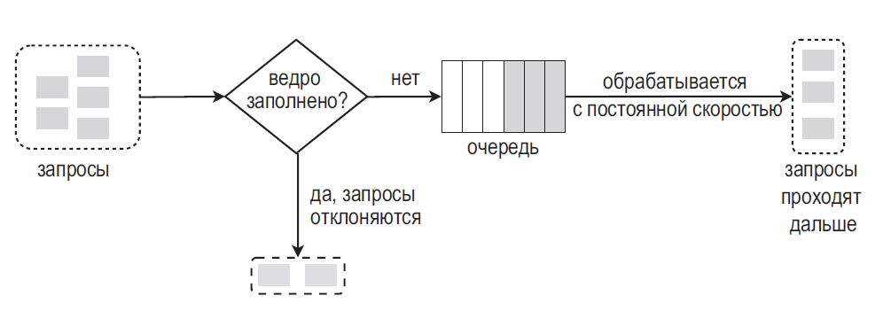
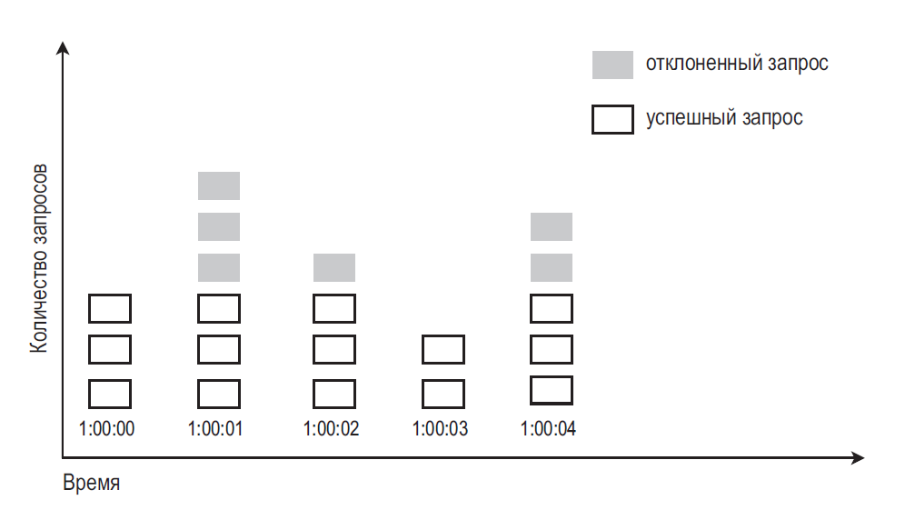
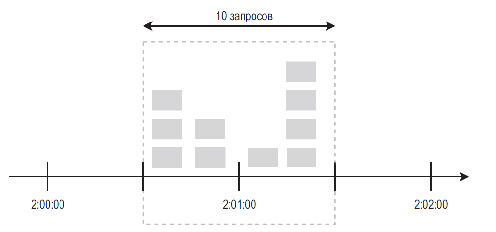
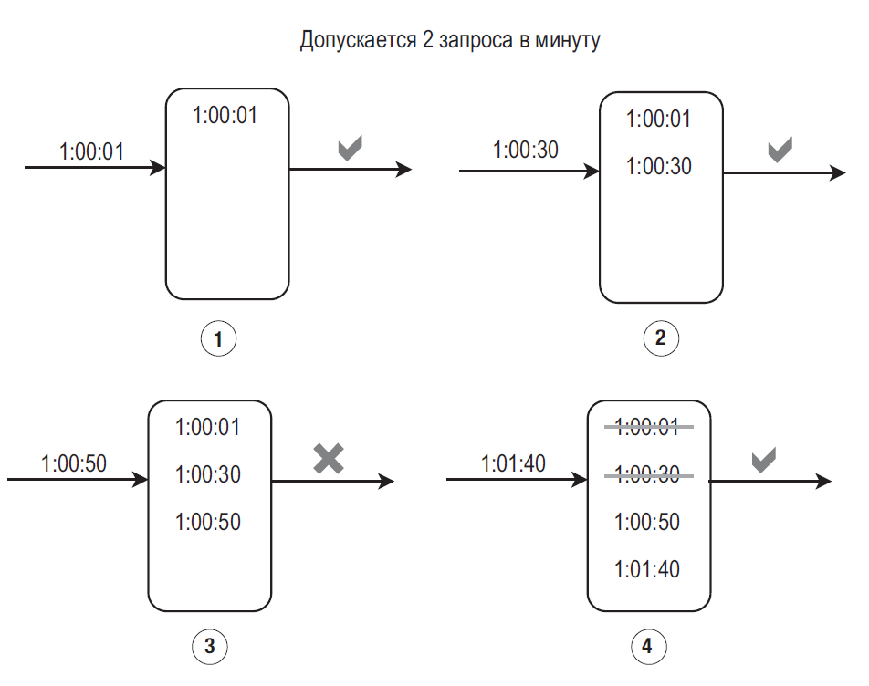
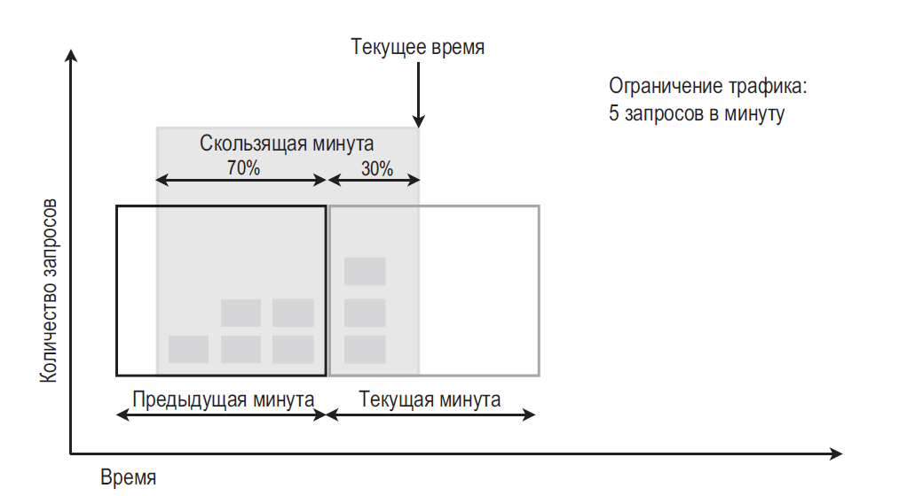
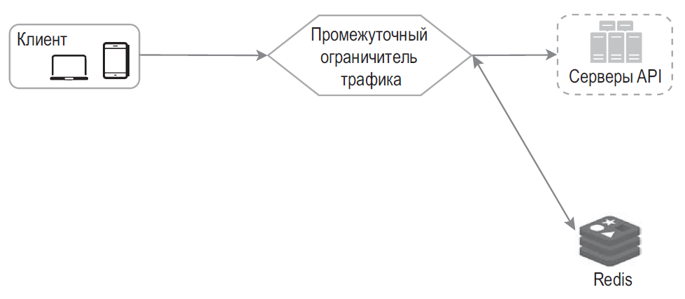
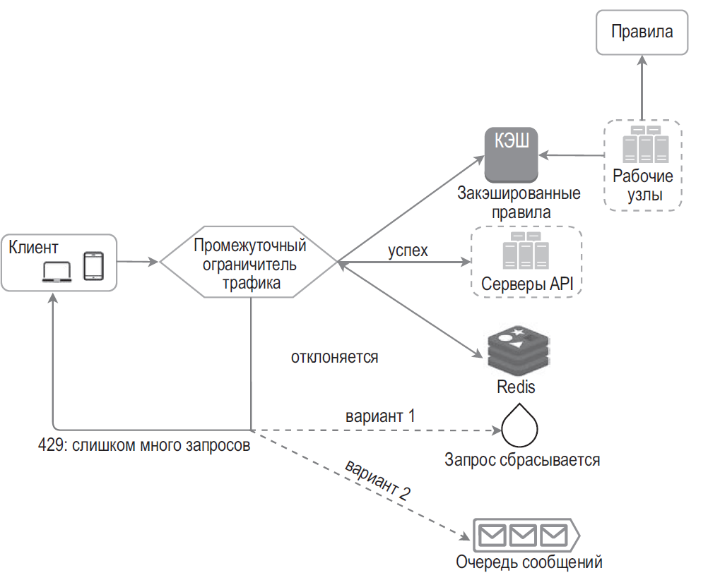

## ПРОЕКТИРОВАНИЕ ОГРАНИЧИТЕЛЯ ТРАФИКА

Rate limiter ограничивает частоту операций по ключу (пользователь, API-ключ, tenant, IP или ресурс). Перед выбором алгоритма уточните лимит, интервал, допустимый burst, стоимость операции, необходимость глобального или локального лимита и поведение при отказе limiter. При превышении запрос обычно отклоняют; очередь нужна только если её размер и задержку можно ограничить. Примеры:
- пользователь может создать не больше двух сообщений в секунду;
- с одного IP-адреса можно создать не больше 10 учетных записей в день;
- на одном устройстве можно получить не больше 5 наград в неделю.

Ограничение можно реализовать в gateway, сервисе или на обоих уровнях. Gateway удобен для общей политики и защиты входящего трафика; бизнес-квоты и дорогие операции могут требовать лимита в самом сервисе. Универсального ответа нет.

- Проанализируйте ваш текущий технологический стек, включая язык программирования, сервис кэширования и т. д. Убедитесь в том, что язык, который вы используете, позволит вам эффективно реализовать ограничитель трафика на стороне сервера.
- Выберите алгоритм ограничения трафика, который соответствует вашим бизнес-требованиям. Когда все реализуется на стороне сервера, алгоритм находится под вашим полным контролем. Но если вы используете сторонний шлюз, выбор может быть ограничен.
- Если вы уже используете микросервисы и ваша архитектура предусматривает шлюз API для выполнения аутентификации, ведения белых списков IP-адресов и т. д., ограничитель трафика можно добавить в этот шлюз.
- Разработка собственного сервиса для ограничения трафика занимает время. Если ваших инженерных ресурсов для этого недостаточно, лучше выбрать коммерческий шлюз API.

### Алгоритмы ограничения трафика

- **алгоритм маркерной корзины (token bucket)**;
- **алгоритм дырявого ведра (leaking bucket)**;
- **счетчик фиксированных интервалов (fixed window counter)**;
- **журнал скользящих интервалов (sliding window log)**;
- **счетчик скользящих интервалов (sliding window counter)**.

#### алгоритм маркерной корзины (token bucket)

Алгоритм маркерной корзины (**token bucket**) принимает два параметра:
- размер корзины: максимальное количество маркеров, которое может в ней находиться;
- частота пополнения: количество маркеров, ежесекундно добавляемых в корзину.

Сколько корзин нам нужно? Это зависит от правил ограничения трафика. Вот несколько примеров.
- Для разных конечных точек API обычно нужны разные корзины. Например, если пользователь публикует 1 сообщение в секунду, добавляет 150 друзей в день и «лайкает» 5 сообщений в секунду, каждому пользователю нужно выделить 3 корзины.
- Если нам нужно фильтровать запросы в зависимости от IP-адресов, каждому IP-адресу требуется корзина.
- Если система допускает не больше 10 000 запросов в секунду, логично предусмотреть глобальную корзину для всех запросов.

#### алгоритм дырявого ведра (leaking bucket);
Алгоритмы дырявого ведра и маркерной корзины очень похожи, только **первый обрабатывает запросы с фиксированной скоростью**. Обычно его реализуют с использованием очереди типа FIFO

запросы обрабатываются с постоянной скоростью, поэтому этот алгоритм подходит для задач, которые требуют стабильной скорости обработки.

#### счетчик фиксированных интервалов (fixed window counter);

система допускает не больше 5 запросов в минуту, а квота ради удобства сбрасывается ежеминутно. Как видите, на интервале между 2:00:00 и 2:01:00 имеется пять запросов и еще пять — между 2:01:00 и 2:02:00. Таким образом, за одну минуту, между 2:00:30 и 2:01:30, система принимает 10 запросов — в два раза больше позволенного.

**Недостаток фиксированного окна**: всплески трафика на границе временных интервалов могут привести к приему запросов, количество которых превышает квоту.

#### журнал скользящих интервалов (sliding window log);
Алгоритм следит за временными метками запросов. Временные метки обычно хранятся в кэше, например, в упорядоченных множествах Redis

- Когда в 1:00:01 приходит новый запрос, журнал пуст, поэтому запрос принимается.
- В 1:00:30 приходит новый запрос, и временная метка 1:00:30 записывается в журнал. После этого размер журнала равен 2, что не превышает допустимое значение. Запрос принимается.
- В 1:00:50 приходит новый запрос, лимит уже исчерпан, поэтому запрос отклоняется. В журнал принятых запросов обычно добавляют timestamp только после решения принять запрос; отклонённые попытки можно учитывать отдельно для защиты или аналитики.
- В 1:01:40 приходит новый запрос. Запросы в диапазоне [1:00:40,1:01:40) находятся на текущем временном интервале, а запросы, отправленные до 1:00:40, являются устаревшими. Две просроченные временные метки, 1:00:01 и 1:00:30, удаляются из журнала. После этого размер журнала равен 2, поэтому запрос принимается.

**Преимущество скользящего журнала**: ограничение трафика, реализованное с помощью этого алгоритма, получается очень точным; на любом скользящем интервале запросы не превышают заданный лимит.

**Недостаток**: память и число операций пропорциональны количеству запросов в окне. Не добавляйте отклонённые попытки в журнал принятых запросов, если это не является явно выбранной политикой.

#### Счетчик скользящих интервалов (sliding window counter)

Преимущества:
- сглаживание всплесков трафика: текущая частота запросов зависит от той, которая использовалась на предыдущем интервале;
- экономия памяти.

### Общая архитектура и состояние

Локальный limiter быстрый и переживает потерю центрального хранилища, но каждый экземпляр может разрешить собственную квоту. Redis помогает разделить состояние между экземплярами, однако добавляет задержку и становится зависимостью.

Redis предлагает `INCR` и `EXPIRE`, но несколько команд должны выполняться атомарно: иначе параллельные запросы или сбой между командами могут нарушить лимит. Для счётчика используют Lua/Function или другой атомарный паттерн.

### Подробная архитектура

Клиенту можно сообщить лимит и остаток через `RateLimit-Limit`, `RateLimit-Remaining`, `RateLimit-Reset` (если используется соответствующая спецификация), а время ожидания перед повтором — через `Retry-After`. Не раскрывайте внутренние лимиты, если это помогает обходу anti-abuse-политики.

При превышении лимита обычно возвращается **HTTP 429 Too Many Requests** и, если можно оценить ожидание, `Retry-After`.

Промежуточный ограничитель загружает правила и атомарно проверяет/обновляет состояние. Заранее определите поведение при timeout или недоступности Redis:
- если запрос не отклоняется, он направляется к серверам API;
- если запрос отклоняется, ограничитель трафика возвращает клиенту код ошибки 429. Тем временем запрос либо сбрасывается, либо направляется в очередь.

### Ограничитель трафика в распределенном окружении

В распределённом limiter ключ строится по проверенному identity и области лимита. IP за reverse proxy учитывайте только через доверенную цепочку proxy, иначе клиент может подменить forwarded-заголовок. Локальная квота на каждом экземпляре проще, но становится приблизительной относительно общего лимита.

## Вопросы на собеседовании

### Какой алгоритм выбрать?

Fixed window прост, но допускает всплеск на границе интервалов; sliding log точен, но дороже по памяти; sliding counter экономит ресурсы с приближением; token bucket ограничивает среднюю скорость и разрешённый burst. Выбор зависит от контракта и цены запроса.

### Что делать при отказе Redis?

Для дешёвого чтения можно временно fail-open с локальным лимитом; для защиты дорогой операции — fail-closed или более строгий fallback. Нужны таймауты, метрики и защита от переноса всей нагрузки на backend.

