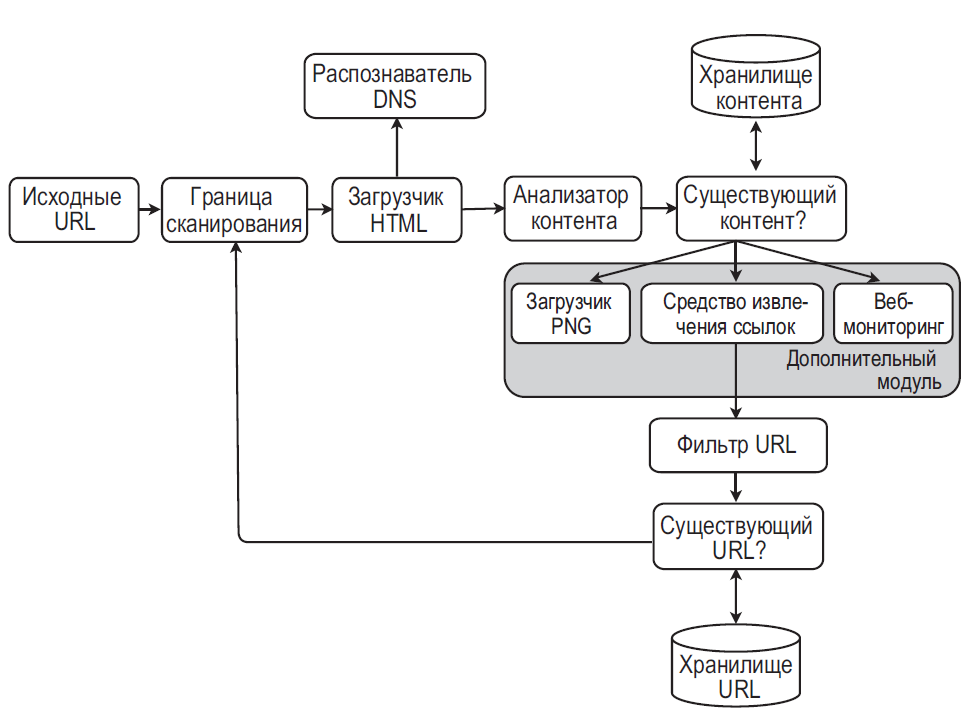

## Проектирование поискового робота (crawler)

### Требования и границы

Уточните число URL/s, максимальный объём хранилища, языки/типы контента, глубину обхода, частоту повторного обхода, сроки индексации и допустимую задержку. Crawler должен уважать `robots.txt`, политику владельца сайта и ограничения частоты; он не должен перегружать источник.

### Конвейер обхода

1. Seeds и ссылки попадают в **frontier** — хранилище ожидающих URL с приоритетом, временем следующего обхода и статусом.
2. Scheduler выбирает URL, соблюдая лимиты параллелизма/delay на host и `Retry-After`.
3. Stateless fetcher получает страницу с ограничением размера, времени и типов контента.
4. Ответ проверяется: HTTP status, MIME type, robots/meta directives, canonical URL и политика повторов.
5. Нормализованный URL проверяется в visited store; content fingerprint помогает дедуплицировать одинаковое содержимое по разным URL.
6. Parser извлекает текст и ссылки; допустимые новые ссылки нормализуются и ставятся в frontier, документ отправляется в storage/index pipeline.

Bloom filter может быстро отсеять URL, которые точно уже видели, но ложноположительный результат способен пропустить новый URL. Для решений, где пропуск недопустим, нужна точная проверка/периодическая сверка.

### Архитектура и масштабирование

- **Frontier** партиционируют, например, по host, чтобы соблюдать politeness и не открывать чрезмерное число запросов к одному сайту.
- **Fetchers** масштабируются горизонтально; lease/ack и повторная постановка в очередь позволяют пережить падение worker-а.
- **Content store** хранит сырой/нормализованный документ, а индекс — поля для поиска. Это разные профили чтения и retention.
- Revisit scheduler пересчитывает приоритет по свежести/изменчивости; повторные fetch должны быть идемпотентными.
- Очередь может доставлять задание повторно. После crash между fetch и сохранением результата возможна повторная загрузка; обработка должна быть безопасной к повторам.

### Ограничения и отказные сценарии

- Рендеринг JavaScript дорог и не нужен для всех страниц; используйте его только для обоснованного сегмента и с отдельными лимитами.
- Сетевые ошибки, `429` и `5xx` повторяйте ограниченно с backoff/jitter; постоянные ошибки и запрещённые URL не должны бесконечно возвращаться в очередь.
- Ограничивайте скачиваемый размер, redirects и время ответа. Проверяйте адрес назначения и повторные DNS-разрешения, чтобы fetcher не обращался к внутренним/запрещённым сетям.
- Обрабатывайте canonical и дубликаты аккуратно: одинаковое содержимое по разным URL не всегда означает, что один URL нужно удалить из индекса.
- Индексация асинхронна, поэтому между обнаружением страницы и поиском по ней есть lag; мониторьте очередь, ошибки fetch и возраст frontier.

### Вопросы на собеседовании

#### Как не сканировать один host слишком агрессивно?

Хранить планирование и лимиты по host, распределять работу с сохранением этой группировки и применять backoff/`Retry-After`. Общий лимит worker-ов без host-aware scheduling не защищает отдельный сайт.

#### Для чего нужен Bloom filter?

Он быстро отвечает «точно нет» или «возможно да» для проверки ранее встречавшегося URL. Он экономит обращения к хранилищу, но при ложноположительном ответе нельзя без проверки окончательно пропустить ссылку.
