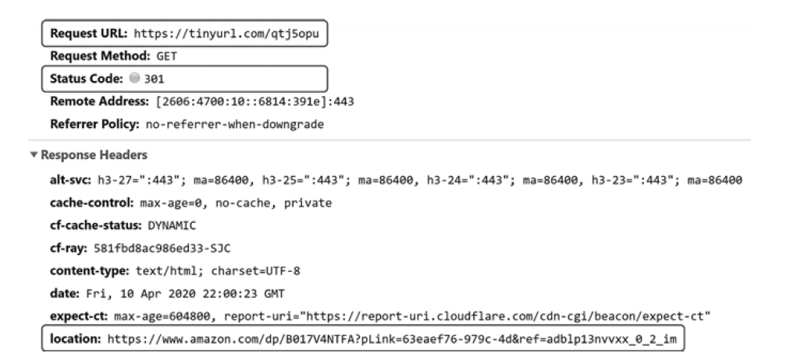
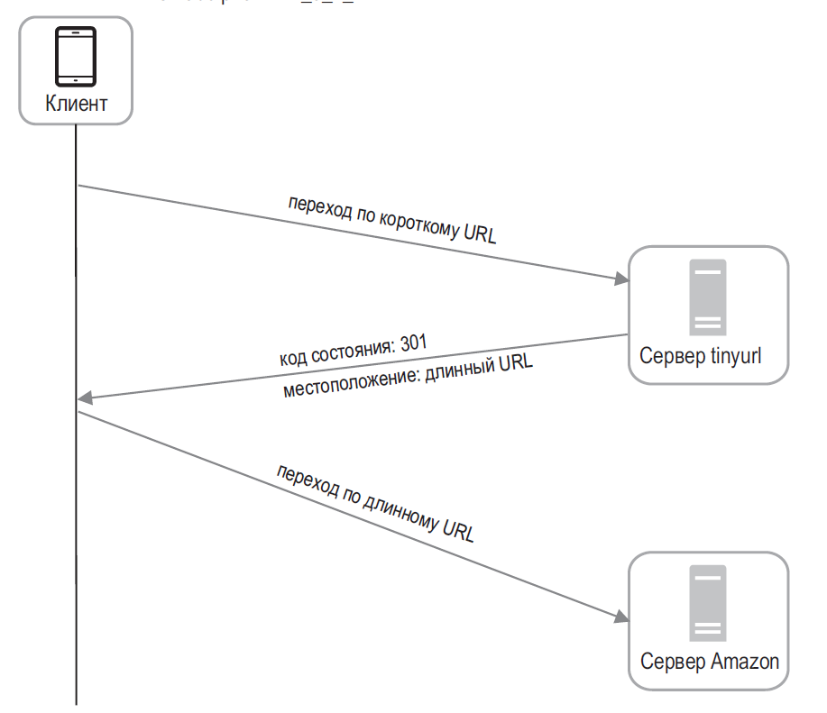

## Проектирование сервиса коротких ссылок

### Требования и API

Уточните, нужны ли custom alias, срок жизни, редактирование/отзыв, аналитика кликов, приватные ссылки и лимиты создания. Короткая ссылка — публичный токен, поэтому важны устойчивость к перебору, проверка допустимого URL и защита от злоупотреблений.

Пример API:

- `POST /links` — создать ссылку (идемпотентный request key при необходимости);
- `GET /{code}` — перенаправить на исходный URL;
- `DELETE /links/{code}` — отозвать ссылку, если владелец авторизован.

### Генерация короткого кода

Варианты: последовательный ID с Base62, случайный код с проверкой уникальности или заранее выделенные диапазоны ID. Последовательность эффективна, но предсказуема; случайный код сложнее угадать, но вероятность коллизии растёт с количеством ссылок. Для любого варианта БД должна иметь unique constraint, а конфликт создания — ограниченно повторяться. Custom alias резервируется атомарно.

### Запись и перенаправление

1. При создании проверить URL-схему и правила продукта, сгенерировать code.
2. Сохранить `code → destination, owner, createdAt, expiresAt, status` в источнике истины; уникальный индекс защищает от гонки кодов.
3. При переходе проверить статус/TTL, затем искать сначала в кеше и при промахе читать БД.
4. Вернуть redirect на клиент; отдельно и асинхронно отправить событие клика в аналитику.

### 301, 302, 307 и кэширование

- `301` — постоянное перенаправление; браузер/CDN могут его кешировать, поэтому последующий переход может не попасть в сервис и аналитика/отзыв будут ограничены.
- `302` — временное перенаправление; часто используют для GET-ссылок, когда переходы нужно учитывать. Оно также может кешироваться по заголовкам.
- `307`/`308` сохраняют HTTP-метод при перенаправлении; выбирайте их, если важна семантика метода.

Код ответа не заменяет `Cache-Control`; нужный статус зависит от требований к аналитике, отзыву, свежести и клиентскому поведению.

### Масштабирование и отказоустойчивость

- Stateless web-узлы масштабируются горизонтально; состояние хранится в БД/кеше.
- Кеширование популярных code снижает нагрузку на БД, но отзыв должен инвалидировать кеш или иметь ограниченный TTL.
- Аналитические клики отправляйте асинхронно, если потеря отдельного события допустима; для строгих отчётов проектируйте durable ingestion, deduplication и retention.
- Реплики чтения могут отставать; сразу после создания ссылка может не находиться при чтении с replica. Обеспечьте read-after-write либо маршрутизируйте свежую запись на primary.
- Ограничивайте частоту создания и кликов, обнаруживайте вредоносные ссылки и не допускайте redirect на неподдерживаемые схемы.

### Вопросы на собеседовании

#### Какой код выбрать для кликов?

Часто `302`/`307` и подходящие cache headers, чтобы переходы наблюдались сервисом. `301` может быть эффективнее для постоянной ссылки, но клиентский кеш мешает отзыву и учёту каждого клика.

#### Как обеспечить уникальность кода?

Уникальный индекс в БД — финальная гарантия. Генератор снижает вероятность конфликта, но при гонке нужно обработать constraint violation и ограниченно сгенерировать новый code.
