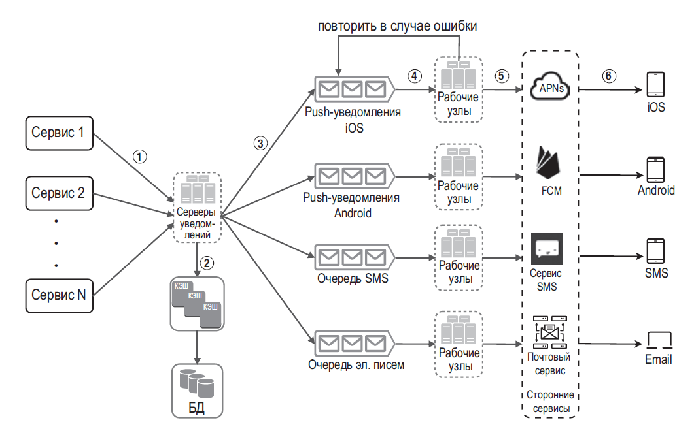

## Проектирование сервиса доставки SMS/уведомлений

### Требования

Уточните каналы (SMS, email, push), ожидаемый объём и пики, приоритеты, срок актуальности сообщения, подтверждения доставки, региональные ограничения, согласие пользователя и допустимые повторы. Для OTP важны короткий TTL, лимит попыток и защита от перебора; обычную кампанию можно отправлять асинхронно.

### Основной поток

1. Бизнес-сервис фиксирует событие вместе с outbox-записью в своей транзакции.
2. Dispatcher читает outbox и публикует задачу с `notificationId`, user/channel, шаблоном, приоритетом и `expiresAt`.
3. Worker проверяет user preferences/consent, формат номера, лимиты tenant/provider и срок актуальности.
4. Worker вызывает provider с ограниченным timeout и idempotency key, если API провайдера это поддерживает.
5. Статусы `accepted`, `sent`, `delivered`, `failed` хранятся раздельно: ответ провайдера «принято» не обязательно означает доставку на устройство.

### Повторы и отказы

- Для временных ошибок (timeout, rate limit, часть 5xx) — ограниченный exponential backoff с jitter и учётом `Retry-After`.
- Для постоянных ошибок (невалидный номер, отказ пользователя) — не повторять; сохранить причину и применить бизнес-политику.
- Timeout после отправки неоднозначен: провайдер мог принять SMS, а ответ потеряться. Без idempotency key повтор может создать дубликат; exactly-once внешний эффект обычно недостижим.
- После максимума попыток отправить задачу в DLQ/ручную обработку с алертом. Не продолжать retry после `expiresAt`, особенно для одноразовых кодов.
- Ограничивайте параллелизм отдельно по provider/tenant; сбой провайдера не должен занимать все worker-ы.

### Масштабирование и эксплуатация

Очередь сглаживает пики и позволяет независимо масштабировать worker-ы. При росте очереди мониторьте возраст старейшей задачи, lag, rate ошибок и quota provider-а. Нужны резервный provider/channel, если допустимы переключение и дополнительные расходы; fallback может доставить сообщение повторно или с задержкой.

Соблюдайте opt-out и quiet hours, минимизируйте персональные данные в логах, шифруйте чувствительные поля и ограничивайте доступ к текстам сообщений. Секреты provider-а хранятся в secret manager, а не в очереди/логах.

### Вопросы на собеседовании

#### Можно ли гарантировать, что SMS уйдёт ровно один раз?

Нет, если provider не поддерживает надёжный idempotency key и результат запроса может быть неизвестен после timeout. Проектируйте доставку как at-least-once попытки с дедупликацией, статусами и допустимой обработкой дублей.

#### Что именно означает «доставлено»?

Это зависит от подтверждения provider-а: API-принятие, передача в carrier и доставка конечному устройству — разные статусы и гарантии. В контракте продукта нужно определить, какой уровень подтверждения требуется.
